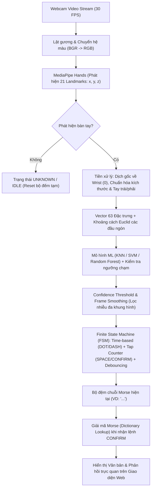
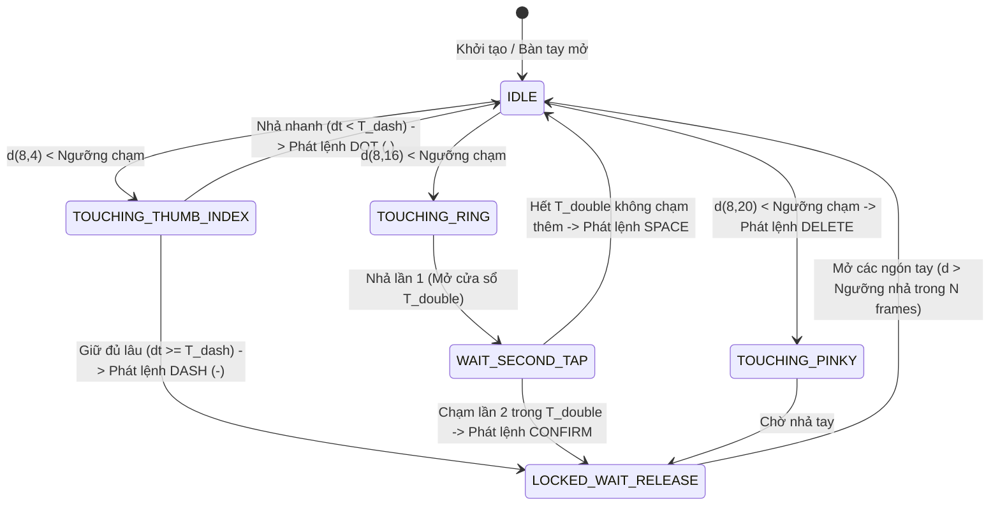
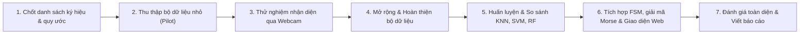

# Hệ Thống Giải Mã Mã Morse & Nhận Diện Cử Chỉ Tay Thời Gian Thực Qua Webcam
**(Real-Time Webcam Hand Gesture & Morse Code Decoder System)**

> 🇻🇳 **[Phiên bản Tiếng Việt](#phiên-bản-tiếng-việt-vietnamese-version)** | 🇬🇧 **[English Version Below](#english-version)**

---

<a name="phiên-bản-tiếng-việt-vietnamese-version"></a>
# 🇻🇳 PHIÊN BẢN TIẾNG VIỆT (VIETNAMESE VERSION)

## Mục Lục
- [Chương 1: Tổng Quan Đề Tài & Phạm Vi Hệ Thống](#chương-1-tổng-quan-đề-tài--phạm-vi-hệ-thống)
- [Chương 2: Cơ Sở Lý Thuyết, Sơ Đồ Bàn Tay & Quy Luật Cử Chỉ](#chương-2-cơ-sở-lý-thuyết-sơ-đồ-bàn-tay--quy-luật-cử-chỉ)
- [Chương 3: Thu Thập, Gán Nhãn & Nghiên Cứu Dữ Liệu](#chương-3-thu-thập-gán-nhãn--nghiên-cứu-dữ-liệu)
- [Chương 4: Kiến Trúc Mô Hình, Máy Trạng Thái (FSM) & Tối Ưu Hóa](#chương-4-kiến-trúc-mô-hình-máy-trạng-thái-fsm--tối-ưu-hóa)
- [Chương 5: Thiết Kế Giao Diện Website & Hướng Dẫn Thao Tác](#chương-5-thiết-kế-giao-diện-website--hướng-dẫn-thao-tác)
- [Chương 6: Đánh Giá Hệ Thống & Thực Nghiệm](#chương-6-đánh-giá-hệ-thống--thực-nghiệm)
- [Chương 7: Công Nghệ Sử Dụng, Cấu Trúc Thư Mục & Cài Đặt](#chương-7-công-nghệ-sử-dụng-cấu-trúc-thư-mục--cài-đặt)
- [Chương 8: Đề Cương Báo Cáo, Sản Phẩm Bàn Giao & Lộ Trình Thực Hiện](#chương-8-đề-cương-báo-cáo-sản-phẩm-bàn-giao--lộ-trình-thực-hiện)

---

## Chương 1: Tổng Quan Đề Tài & Phạm Vi Hệ Thống

### 1.1. Giới thiệu
**Morse Code Decoder Webcam** là hệ thống thị giác máy tính (Computer Vision) kết hợp học máy (Machine Learning) hoạt động trong thời gian thực. Hệ thống sử dụng webcam tiêu chuẩn để theo dõi bàn tay người dùng thông qua **MediaPipe Hands**, nhận diện các cử chỉ ngón tay quy ước, kết hợp với bộ phân loại theo thời gian (**Time-based Classification**) và máy trạng thái hữu hạn (**Finite State Machine - FSM**) để biên dịch thao tác tay thành chuỗi tín hiệu **Morse (`.` / `-`)** và giải mã thành văn bản hoàn chỉnh.

### 1.2. Phạm vi hoạt động (Hai chế độ độc lập dùng chung Webcam)
Hệ thống được thiết kế hỗ trợ hai chế độ hoạt động độc lập nhưng chia sẻ chung luồng video từ webcam:

| Chế độ (Mode) | Đầu vào (Input) | Cơ chế xử lý | Kết quả đầu ra (Output) |
| :--- | :--- | :--- | :--- |
| **1. Chế độ Morse (Morse Mode)** | Người dùng thực hiện các cử chỉ chạm ngón tay quy ước (`DOT`, `DASH`, `CONFIRM`, `SPACE`, `DELETE`). | Nhận diện từng tín hiệu `.` hoặc `-` qua thời gian giữ và số lần chạm → Ghép chuỗi Morse → Tra bảng từ điển giải mã. | Ký tự chữ cái (A–Z), chữ số (0–9) và ghép thành câu văn bản. |
| **2. Chế độ Ký hiệu tay cơ bản (Static Sign Mode)** | Người dùng thực hiện từng ký hiệu tay tĩnh độc lập trước webcam. | Trích xuất vector 63 đặc trưng từ 21 điểm mốc → Phân loại bằng mô hình ML (KNN / SVM / Random Forest). | Nhận diện từng ký hiệu đơn lẻ rồi ghép dần thành văn bản. |

> [!IMPORTANT]
> **Lưu ý phân biệt phạm vi khoa học:**
> Nhận diện một số ký hiệu tay tĩnh hoặc cử chỉ quy ước **chưa phải là dịch toàn bộ ngôn ngữ ký hiệu (Sign Language Translation)**. Giao tiếp ngôn ngữ ký hiệu đầy đủ trong thực tế còn phụ thuộc vào chuỗi chuyển động liên tục (dynamic gestures), biểu cảm khuôn mặt (facial expressions), ngữ cảnh và tư thế cơ thể (body posture). Đề tài này tập trung giải quyết bài toán nhận diện ký hiệu rời rạc và nhập liệu văn bản qua quy ước mã Morse.

---

## Chương 2: Cơ Sở Lý Thuyết, Sơ Đồ Bàn Tay & Quy Luật Cử Chỉ

### 2.1. Sơ đồ 21 điểm mốc bàn tay (MediaPipe Hands 21 Landmarks)
Hệ thống sử dụng **MediaPipe Hands** để trích xuất **21 điểm mốc 3D (Landmarks)** trên bàn tay trong mỗi khung hình. Mỗi điểm mốc bao gồm 3 tọa độ không gian $(x, y, z)$, tạo thành vector đặc trưng kích thước $21 \times 3 = 63$ giá trị.

```text
                 8 (INDEX_DIP/TIP)   12 (MIDDLE_TIP)  16 (RING_TIP)
                     ●                   ●                ●
                     |                   |                |
                     7                   11               15          20 (PINKY_TIP)
                     |                   |                |            ●
                     6                   10               14           |
                     |                   |                |           19
    4 (THUMB_TIP)    5 (INDEX_MCP)       9 (MIDDLE_MCP)   13 (RING)    |
        ●            ●-------------------●----------------●           18
         \          /                                      \           |
          3        /                                        \         17 (PINKY_MCP)
           \      /                                          \-------●
            2    /                                                  /
             \  /                  LÒNG BÀN TAY                    /
              1 (THUMB_CMC)           (PALM)                      /
               \                                                 /
                \--------------------- 0 -----------------------/
                                    (WRIST - Cổ tay)
```

#### Danh sách các điểm mốc quan trọng dùng trong điều khiển cử chỉ Morse:
- **`0` (WRIST)**: Điểm gốc cổ tay — dùng làm gốc tọa độ chuẩn hóa.
- **`4` (THUMB_TIP)**: Đầu ngón cái — mốc tham chiếu chạm chính (kết hợp hoặc đối chiếu với ngón trỏ).
- **`8` (INDEX_FINGER_TIP)**: Đầu ngón trỏ — ngón chủ đạo thực hiện thao tác chạm.
- **`12` (MIDDLE_FINGER_TIP)**: Đầu ngón giữa.
- **`16` (RING_FINGER_TIP)**: Đầu ngón áp út.
- **`20` (PINKY_TIP)**: Đầu ngón út.

---

### 2.2. Quy ước 5 cử chỉ điều khiển Morse (Control Gestures)
> *Lưu ý: Đây là bộ cử chỉ điều khiển được thiết kế tối ưu cho thao tác nhập liệu ứng dụng, không phải bộ ký hiệu ngôn ngữ ký hiệu tiêu chuẩn.*

| STT | Nhãn (Label) | Cử chỉ minh họa (Quy ước ngón tay) | Số lần / Thời gian | Chức năng hệ thống |
| :-: | :--- | :--- | :--- | :--- |
| **1** | `DOT` (`.`) | **Ngón trỏ (`8`) & Ngón cái (`4`)** chạm nhanh vào nhau | Chạm nhanh **1 lần** ($T_{\text{min}} \le \Delta t < T_{\text{dash}}$) | Nhập tín hiệu chấm (`.`) vào chuỗi Morse hiện tại |
| **2** | `DASH` (`-`) | **Ngón trỏ (`8`) & Ngón cái (`4`)** *(hoặc ngón giữa `12` theo cấu hình)* giữ chạm | Giữ chạm **1 lần** đủ lâu ($\Delta t \ge T_{\text{dash}}$) | Nhập tín hiệu gạch (`-`) vào chuỗi Morse hiện tại |
| **3** | `CONFIRM` | **Ngón trỏ (`8`) & Ngón áp út (`16`)** *(hoặc cái & áp út)* chạm liên tiếp | Chạm **2 lần liên tiếp** (Double-tap trong cửa sổ $T_{\text{double}}$) | Kết thúc chuỗi Morse hiện tại và giải mã thành 1 ký tự |
| **4** | `SPACE` | **Ngón trỏ (`8`) & Ngón áp út (`16`)** *(hoặc cái & áp út)* chạm đơn | Chạm **1 lần** (Không có lần chạm thứ 2 trong $T_{\text{double}}$) | Thêm khoảng trắng (` `) ngăn cách giữa các từ |
| **5** | `DELETE` | **Ngón trỏ (`8`) & Ngón út (`20`)** *(hoặc cái & út)* chạm vào nhau | Chạm **1 lần** | Xóa tín hiệu Morse cuối cùng (hoặc xóa ký tự vừa nhập) |

---

### 2.3. Công thức toán học & Quy luật nhận diện (Mathematical Rules)

#### 1. Khoảng cách Euclid (Euclidean Distance)
Để phát hiện hai đầu ngón tay $i$ và $j$ có chạm vào nhau hay không, hệ thống tính khoảng cách Euclid trong mặt phẳng 2D (hoặc 3D đã chuẩn hóa kích thước bàn tay):

$$d(i, j) = \sqrt{(x_i - x_j)^2 + (y_i - y_j)^2}$$

Để bất biến với khoảng cách từ bàn tay tới camera (xa/gần), khoảng cách $d(i, j)$ được chuẩn hóa theo kích thước tham chiếu của bàn tay $L_{\text{ref}}$ (ví dụ khoảng cách từ cổ tay `0` đến khớp gốc ngón giữa `9`):

$$\hat{d}(i, j) = \frac{\sqrt{(x_i - x_j)^2 + (y_i - y_j)^2}}{\sqrt{(x_9 - x_0)^2 + (y_9 - y_0)^2 + \epsilon}}$$

- **Điều kiện chạm (Touch Condition):** $\hat{d}(i, j) < \theta_{\text{touch}}$ (Ngưỡng chạm).
- **Điều kiện nhả / nghỉ (Release Condition - Hysteresis):** $\hat{d}(i, j) > \theta_{\text{release}}$ với $\theta_{\text{release}} > \theta_{\text{touch}}$ nhằm tránh hiện tượng nhấp nháy ở biên ngưỡng.

#### 2. Quy luật phân biệt `DOT` và `DASH` (Time-based Classification)
Khi phát hiện cặp ngón (`8`, `4`) bắt đầu chạm tại thời điểm $t_{\text{start}}$ và rời nhau tại thời điểm $t_{\text{end}}$, thời gian giữ chạm là $\Delta t = t_{\text{end}} - t_{\text{start}}$:
- Nếu $\Delta t < T_{\text{noise}}$ (ví dụ $< 50\text{ ms}$): Bỏ qua (nhiễu khung hình).
- Nếu $T_{\text{noise}} \le \Delta t < T_{\text{dash}}$ (ví dụ $50\text{ ms} \le \Delta t < 400\text{ ms}$): Ghi nhận **`DOT` (`.`)**.
- Nếu $\Delta t \ge T_{\text{dash}}$ (ví dụ $\ge 400\text{ ms}$): Ghi nhận **`DASH` (`-`)** ngay khi đạt ngưỡng (hoặc khi nhả tay), sau đó khóa trạng thái chờ người dùng mở tay về trạng thái nghỉ (`IDLE`).

#### 3. Quy luật phân biệt `SPACE` và `CONFIRM` (Tap Counter Window)
Khi cặp ngón điều khiển (`8` & `16`) chạm và nhả lần thứ nhất tại $t_1$:
- Hệ thống mở một cửa sổ thời gian chờ $T_{\text{double}}$ (ví dụ $350\text{ ms}$).
- Nếu có **lần chạm thứ 2** xảy ra trong khoảng $(t_1, t_1 + T_{\text{double}}]$: Kích hoạt **`CONFIRM`** (giải mã chuỗi Morse hiện tại thành chữ).
- Nếu hết thời gian $T_{\text{double}}$ mà không có lần chạm thứ 2: Kích hoạt **`SPACE`** (thêm dấu cách).

---

### 2.4. Bảng quy đổi Mã Morse Quốc Tế (Morse Lookup Dictionary)

| Ký tự | Mã Morse | Ký tự | Mã Morse | Ký tự | Mã Morse | Số | Mã Morse |
| :-: | :--- | :-: | :--- | :-: | :--- | :-: | :--- |
| **A** | `.-` | **J** | `.---` | **S** | `...` | **0** | `-----` |
| **B** | `-...` | **K** | `-.-` | **T** | `-` | **1** | `.----` |
| **C** | `-.-.` | **L** | `.-..` | **U** | `..-` | **2** | `..---` |
| **D** | `-..` | **M** | `--` | **V** | `...-` | **3** | `...--` |
| **E** | `.` | **N** | `-.` | **W** | `.--` | **4** | `....-` |
| **F** | `..-.` | **O** | `---` | **X** | `-..-` | **5** | `.....` |
| **G** | `--.` | **P** | `.--.` | **Y** | `-.--` | **6** | `-....` |
| **H** | `....` | **Q** | `--.-` | **Z** | `--..` | **7** | `--...` |
| **I** | `..` | **R** | `.-.` | | | **8** | `---..` |
| | | | | | | **9** | `----.` |

---

## Chương 3: Thu Thập, Gán Nhãn & Nghiên Cứu Dữ Liệu

### 3.1. Quy định gán nhãn dữ liệu (Data Labeling Specification)
Mỗi mẫu dữ liệu (vector 63 đặc trưng hoặc chuỗi khung hình) được gán một nhãn duy nhất:

| STT | Nhãn (Label) | Quy định thực hiện chuẩn khi thu thập | Ý nghĩa điều khiển |
| :-: | :--- | :--- | :--- |
| **1** | `DOT` | Ngón trỏ và ngón cái chạm nhanh 1 lần, các ngón còn lại mở tự nhiên | Tín hiệu chấm `.` |
| **2** | `DASH` | Ngón trỏ và ngón cái giữ chạm rõ ràng (hoặc cử chỉ đại diện cho gạch) | Tín hiệu gạch `-` |
| **3** | `CONFIRM` | Ngón trỏ và ngón áp út chạm 2 lần liên tiếp | Xác nhận, giải mã ký tự |
| **4** | `SPACE` | Ngón trỏ và ngón áp út chạm 1 lần | Thêm khoảng trắng |
| **5** | `DELETE` | Ngón trỏ và ngón út chạm 1 lần | Xóa dữ liệu |
| **6** | `IDLE` / `UNKNOWN` | Bàn tay mở tự nhiên (trạng thái nghỉ) hoặc các tư thế ngoài quy ước | Trạng thái nghỉ / Chống nhận nhầm |

#### Nguyên tắc gán nhãn nghiêm ngặt:
1. **Tính đơn trị:** Mỗi mẫu dữ liệu chỉ được gán một nhãn duy nhất tương ứng với cử chỉ thực hiện.
2. **Đa dạng môi trường:** Thu thập trong nhiều điều kiện ánh sáng (sáng phòng, ánh sáng tự nhiên, ánh sáng yếu), nhiều góc nghiêng bàn tay và khoảng cách xa/gần webcam (30 cm – 80 cm).
3. **Kiểm soát chất lượng (Data Cleaning):** Loại bỏ hoàn toàn các khung hình bị nhòe chuyển động nặng (motion blur), che khuất đầu ngón tay (self-occlusion), MediaPipe không bắt đủ 21 điểm mốc hoặc gán nhãn sai.
4. **Tính nhất quán:** Nhãn dữ liệu phải thống nhất xuyên suốt từ khâu thu thập, tiền xử lý, huấn luyện đến kiểm thử.

---

### 3.2. Chia tập dữ liệu chống rò rỉ (Data Splitting Strategy)

| Tập dữ liệu | Tỷ lệ tham khảo | Công dụng chính | Nguyên tắc phân tách bắt buộc |
| :--- | :-: | :--- | :--- |
| **Training Set** | **70%** | Huấn luyện các mô hình KNN, SVM, Random Forest. | **Chia theo người (Subject-wise) hoặc theo phiên quay (Session-wise)** trước khi tách khung hình. Toàn bộ một đoạn video quay liên tục phải thuộc hoàn toàn về một tập duy nhất. |
| **Validation Set** | **15%** | Chọn siêu tham số (Hyperparameters: $K$ của KNN, $C, \gamma$ của SVM, số cây của RF) và tinh chỉnh ngưỡng thời gian / khoảng cách. | Không được chứa các khung hình trích xuất từ cùng một video với tập Train. |
| **Testing Set** | **15%** | Đánh giá độc lập cuối cùng về độ chính xác và khả năng tổng quát hóa. | Ưu tiên sử dụng người dùng mới hoặc phiên quay độc lập hoàn toàn để phản ánh đúng hiệu năng thực tế. |

> [!WARNING]
> **Cảnh báo Data Leakage (Rò rỉ dữ liệu):**
> Nếu cắt các khung hình liên tiếp từ cùng một video rồi chia ngẫu nhiên (Random Split) vào cả Train và Test, các ảnh gần như giống hệt nhau sẽ xuất hiện ở cả hai tập. Khi đó độ chính xác Test có thể đạt 99% giả tạo nhưng khi chạy webcam thực tế với người mới sẽ thất bại.

---

### 3.3. Khung nghiên cứu & Phân tích dữ liệu (Exploratory Data Analysis - EDA)
Trong báo cáo và quá trình nghiên cứu dữ liệu, dự án trả lời hệ thống 8 câu hỏi cốt lõi:

1. **Nguồn dữ liệu (Data Source):** Dữ liệu tự thu thập qua webcam bằng công cụ thu thập riêng của nhóm hay kết hợp bộ dữ liệu công khai? Đảm bảo quyền sử dụng và sự đồng thuận của người tham gia quay.
2. **Ý nghĩa nhãn (Label Semantics):** Mỗi nhãn biểu diễn cử chỉ điều khiển nào hoặc thuộc bảng chữ cái ký hiệu nào (ASL / VSL / Quy ước Morse)?
3. **Quy mô (Dataset Scale):** Tổng số lớp (classes), tổng số mẫu (samples), số lượng người tham gia (subjects), số phiên quay (sessions), độ phân giải và FPS.
4. **Phân bố lớp (Class Distribution):** Số lượng mẫu giữa các lớp (`DOT`, `DASH`, `CONFIRM`, `SPACE`, `DELETE`, `IDLE`) có cân bằng không? Nếu lệch lớp (class imbalance), xử lý bằng thu thập bổ sung hay trọng số lớp (`class_weight`)?
5. **Chất lượng dữ liệu (Data Quality):** Tỷ lệ khung hình bị mất bàn tay (missing landmarks), ảnh mờ, nhiễu tọa độ $z$, hoặc trùng lặp.
6. **Đặc điểm ký hiệu (Gesture Characteristics):** Phân biệt rõ đâu là tư thế tĩnh (static pose - chỉ cần 1 khung hình) và đâu là cử chỉ phụ thuộc thời gian/nhịp chạm (temporal/dynamic gesture - cần chuỗi khung hình & bộ đếm). Thực hiện bằng 1 tay thuận hay 2 tay?
7. **Khả năng phân biệt & Cặp lớp dễ nhầm (Separability & Confusable Pairs):**
   - *Ví dụ thực nghiệm điển hình:* Cử chỉ chạm ngón áp út (`CONFIRM` / `SPACE`) và chạm ngón út (`DELETE`) khi nhìn nghiêng có thể có tọa độ khớp gần giống nhau dẫn đến nhầm lẫn trên Confusion Matrix. Giải pháp thực nghiệm là bổ sung mẫu ở góc nghiêng $30^\circ - 45^\circ$ và thêm đặc trưng khoảng cách tương đối giữa các đầu ngón tay.
8. **Khả năng áp dụng thực tế (Real-world Applicability):** Dữ liệu thu thập có khớp với điều kiện sử dụng thực tế trên webcam laptop (góc nhìn ngang ngực/mặt, ánh sáng đèn phòng, nền phức tạp) hay không?

---

## Chương 4: Kiến Trúc Mô Hình, Máy Trạng Thái (FSM) & Tối Ưu Hóa

### 4.1. Sơ đồ luồng xử lý tổng thể (System Pipeline Architecture)



---

### 4.2. Trích xuất và Tiền xử lý đặc trưng (Feature Extraction & Preprocessing)
Từ 21 điểm mốc $(x_i, y_i, z_i)$ với $i \in \{0, 1, \dots, 20\}$ do MediaPipe trả về, quy trình chuẩn hóa gồm 4 bước toán học:

1. **Chuẩn hóa điểm gốc về cổ tay (Translation Invariance):**
   Lấy cổ tay $(x_0, y_0, z_0)$ làm gốc tọa độ $(0, 0, 0)$ để vị trí bàn tay ở góc trái hay góc phải màn hình đều cho cùng biểu diễn:

   $$(x'_i, y'_i, z'_i) = (x_i - x_0,\; y_i - y_0,\; z_i - z_0), \quad \forall i \in \{0, \dots, 20\}$$

2. **Chuẩn hóa kích thước bàn tay (Scale Invariance):**
   Chia toàn bộ tọa độ tương đối cho giá trị tuyệt đối lớn nhất $M = \max_{i} \| (x'_i, y'_i, z'_i) \|$ (hoặc chiều dài lòng bàn tay từ điểm `0` đến điểm `9`) để khử sự khác biệt khi để tay gần hoặc xa webcam:

   $$(\tilde{x}_i, \tilde{y}_i, \tilde{z}_i) = \left( \frac{x'_i}{M},\; \frac{y'_i}{M},\; \frac{z'_i}{M} \right)$$

3. **Đồng nhất tay trái / tay phải và ảnh lật gương (Handedness Normalization):**
   Nếu người dùng sử dụng tay trái (so với chuẩn tay phải trong tập huấn luyện), thực hiện đối xứng trục hoành: $\tilde{x}_i \leftarrow -\tilde{x}_i$ để mô hình nhận diện đồng nhất cả hai tay.

4. **Trải phẳng thành Vector 63 chiều (Flattening):**

   $$\mathbf{v} = [\tilde{x}_0, \tilde{y}_0, \tilde{z}_0, \tilde{x}_1, \tilde{y}_1, \tilde{z}_1, \dots, \tilde{x}_{20}, \tilde{y}_{20}, \tilde{z}_{20}] \in \mathbb{R}^{63}$$

---

### 4.3. Huấn luyện và So sánh 3 Thuật toán Machine Learning

| Thuật toán | Nguyên lý hoạt động trong bài toán cử chỉ | Ưu điểm | Hạn chế cần lưu ý |
| :--- | :--- | :--- | :--- |
| **1. KNN (K-Nearest Neighbors)** | Tính khoảng cách giữa vector 63 chiều hiện tại với các mẫu trong tập huấn luyện, bầu chọn theo $K$ láng giềng gần nhất. | Đơn giản, trực quan, không tốn thời gian huấn luyện, hiệu quả với dữ liệu ít chiều. | Tốc độ suy luận (Inference time) chậm dần nếu tập dữ liệu quá lớn; nhạy cảm với nhiễu nếu $K$ quá nhỏ. |
| **2. SVM (Support Vector Machine)** | Tìm siêu phẳng (Hyperplane) có lề cực đại (Maximum Margin) với nhân phi tuyến (RBF Kernel) để phân tách các vùng tư thế bàn tay trong không gian 63 chiều. | Độ chính xác rất cao và ổn định trên vector đặc trưng hình học; suy luận cực nhanh. | Cần chuẩn hóa dữ liệu tốt và tinh chỉnh cặp tham số $(C, \gamma)$ qua GridSearch trên tập Validation. |
| **3. Random Forest (Rừng ngẫu nhiên)** | Tập hợp (Ensemble) nhiều cây quyết định (Decision Trees) huấn luyện trên các tập con đặc trưng và mẫu ngẫu nhiên. | Chống quá khớp (Overfitting) tốt, đánh giá được mức độ quan trọng của từng điểm mốc (Feature Importance). | Kích thước mô hình lớn hơn SVM; xác suất dự đoán có thể phân tán nếu số cây ít. |

---

### 4.4. Máy Trạng Thái Hữu Hạn (FSM) & Cơ Chế Chống Nhập Lặp (Debouncing)
> **Bài toán cốt lõi khi chạy thực tế:** Webcam chạy ở tốc độ 30 FPS (30 khung hình/giây). Nếu người dùng giữ một cử chỉ trong 1 giây mà không có cơ chế kiểm soát trạng thái, hệ thống sẽ nhập liên tiếp **30 dấu chấm (`.`)**!
> **Quy tắc bắt buộc:** *Mỗi lần thực hiện cử chỉ chỉ được ghi nhận đúng 1 lần duy nhất; người dùng bắt buộc phải đưa bàn tay trở về trạng thái nghỉ (`IDLE` / mở ngón tay) trước khi hệ thống cho phép ghi nhận lần nhập tiếp theo.*



#### 6 Cơ chế tối ưu hóa thời gian thực (Real-time Stabilization):
1. **Confidence Threshold (Ngưỡng tin cậy):** Chỉ chấp nhận dự đoán của mô hình ML khi xác suất $\max(P(y|\mathbf{v})) \ge \tau_{\text{conf}}$ (ví dụ $\tau_{\text{conf}} = 0.75$).
2. **Frame Smoothing (Làm mượt liên khung hình):** Sử dụng cửa sổ trượt (Sliding Window $W = 5$ khung hình) lấy nhãn xuất hiện nhiều nhất (Majority Voting) để loại bỏ hiện tượng giật/nhiễu đơn lẻ.
3. **Time-based Classification (Phân loại theo thời gian):** Đo chính xác thời lượng giữ chạm $\Delta t$ để phân biệt `DOT` (chạm nhả nhanh) và `DASH` (chạm giữ).
4. **Debouncing & State Locking (Chống dội & Khóa trạng thái):** Sau khi phát sinh một sự kiện (`DASH`, `CONFIRM`, `DELETE`), hệ thống chuyển ngay sang trạng thái `LOCKED_WAIT_RELEASE`. Mọi khung hình tiếp theo giữ nguyên tư thế đều bị bỏ qua cho đến khi người dùng mở tay hoàn toàn về `IDLE`.
5. **State Management (Quản lý trạng thái):** Tách bạch trạng thái *Đang tích lũy tín hiệu* (`TOUCHING`), *Đang chờ chạm đúp* (`WAIT_SECOND_TAP`), *Đã khóa chờ nhả* (`LOCKED_WAIT_RELEASE`) và *Trạng thái nghỉ* (`IDLE`).
6. **Unknown State Handling (Xử lý ngoại lệ):** Khi không có bàn tay trong khung hình hoặc cử chỉ lạ có độ tin cậy thấp, hiển thị trạng thái `UNKNOWN / IDLE` và giữ nguyên văn bản đã nhập, tuyệt đối không sinh ký tự rác.

---

## Chương 5: Thiết Kế Giao Diện Website & Hướng Dẫn Thao Tác

### 5.1. Sơ đồ bố cục giao diện trang chính (Website UI Wireframe)

```text
+-----------------------------------------------------------------------------------+
|  🛰️ HỆ THỐNG GIẢI MÃ MÃ MORSE & CỬ CHỈ TAY QUA WEBCAM      [Chế độ: Morse ▼]     |
+-----------------------------------------+-----------------------------------------+
|                                         |  📊 KẾT QUẢ NHẬN DIỆN HIỆN TẠI          |
|         🎥 KHU VỰC WEBCAM TRỰC TIẾP     |  - Cử chỉ đang nhận: [ DOT (.)     ]    |
|                                         |  - Độ tin cậy (Conf): [ 96.4% ████░]    |
|     +-----------------------------+     |  - Trạng thái FSM  : [ IDLE / READY]    |
|     |   [Hình ảnh Video + Khung   |     +-----------------------------------------+
|     |    xương 21 điểm MediaPipe  |     |  ⚡ CHUỖI MORSE ĐANG NHẬP (BUFFER)      |
|     |    vẽ trực tiếp lên tay]    |     |  [  . . .                          ]    |
|     |                             |     |  -> Dự kiến giải mã: 'S'                |
|     +-----------------------------+     +-----------------------------------------+
|     FPS: 29.8 | Độ trễ: 12 ms           |  📝 VĂN BẢN ĐÃ XÁC NHẬN (OUTPUT TEXT)   |
|                                         |  +-----------------------------------+  |
|  🎛️ BẢNG ĐIỀU KHIỂN (CONTROLS)          |  | SOS HELLO_                        |  |
|  [▶ Bật/Tắt Camera] [⌫ Xóa ký tự]      |  +-----------------------------------+  |
|  [🗑 Xóa toàn bộ  ] [🔊 Đọc văn bản]    |                                         |
+-----------------------------------------+-----------------------------------------+
|  📖 BẢNG HƯỚNG DẪN CỬ CHỈ & MÃ MORSE TRỰC QUAN                                    |
|  [🤏 Trỏ+Cái 1 lần: DOT (.)] [🤏 Trỏ+Cái giữ: DASH (-)] [✌️ Trỏ+Áp út x2: CONFIRM]|
|  [☝️ Trỏ+Áp út x1: SPACE   ] [🤙 Trỏ+Út x1: DELETE    ] [Bảng tra cứu A-Z, 0-9]   |
+-----------------------------------------------------------------------------------+
```

### 5.2. Chi tiết 6 khu vực chức năng trên Website
1. **Khu vực Webcam:** Hiển thị luồng video trực tiếp (Real-time stream), vẽ đè (overlay) 21 điểm mốc bàn tay, đường nối khớp xương và thanh tiến trình thời gian giữ cử chỉ.
2. **Khu vực Kết quả hiện tại:** Hiển thị nhãn cử chỉ đang nhận diện (`DOT`, `DASH`, `CONFIRM`, `SPACE`, `DELETE`, `IDLE`), mức độ tin cậy (%) và trạng thái khóa Debounce.
3. **Khu vực Chuỗi Morse:** Hiển thị chuỗi tín hiệu `.` và `-` đang tích lũy cho ký tự hiện tại (ví dụ: `...`) kèm gợi ý ký tự tương ứng trước khi xác nhận.
4. **Khu vực Văn bản:** Hiển thị chuỗi các chữ cái và từ đã được xác nhận thành công.
5. **Khu vực Điều khiển:** Các nút bấm trực tiếp trên giao diện (Bật/tắt camera, Xóa 1 tín hiệu/ký tự, Xóa toàn bộ văn bản, Chuyển đổi chế độ hoạt động).
6. **Khu vực Hướng dẫn:** Hình ảnh minh họa trực quan từng cử chỉ ngón tay và bảng tra cứu nhanh mã Morse để người mới có thể sử dụng ngay.

> [!NOTE]
> **Lưu ý kỹ thuật quan trọng khi xây dựng bằng Streamlit:**
> Thành phần mặc định `st.camera_input` của Streamlit chỉ dùng để **chụp ảnh tĩnh (snapshot)**, do đó **không đáp ứng được luồng video nhận diện liên tục theo thời gian thực**. Để truyền và xử lý từng khung hình liên tục (30 FPS), hệ thống cần sử dụng một trong các cơ chế:
> - **`streamlit-webrtc`** (`VideoProcessorBase` / `VideoTransformerBase`) để xử lý luồng WebRTC trực tiếp trên trình duyệt.
> - Vòng lặp đọc khung hình `cv2.VideoCapture(0)` cập nhật vào `st.empty()` / `st.image()` (khi chạy local).
> - Hoặc kiến trúc **FastAPI / Flask (WebSocket / MJPEG Stream) + Frontend HTML/JS**.

---

### 5.3. Ví dụ Kịch bản Thao tác Thực tế (Step-by-Step Walkthrough)
Giả sử người dùng muốn nhập chữ **`S`** (Mã Morse là `...`):
1. **Bước 1:** Mở giao diện web, bật camera và chọn **Chế độ Morse**. Đưa bàn tay lên trước webcam ở tư thế mở tự nhiên (`IDLE`).
2. **Bước 2 (Nhập dấu chấm thứ 1):** Chạm nhanh đầu ngón trỏ và ngón cái vào nhau rồi mở ra → Hệ thống nhận diện `DOT`, chuỗi Morse hiện tại hiển thị `.`.
3. **Bước 3 (Nhập dấu chấm thứ 2 & 3):** Lặp lại thao tác chạm nhanh ngón trỏ và ngón cái thêm 2 lần nữa (mỗi lần đều mở tay về trạng thái nghỉ) → Chuỗi Morse hiện tại cập nhật thành `...`.
4. **Bước 4 (Xác nhận ký tự):** Chạm đầu ngón trỏ và ngón áp út 2 lần liên tiếp → Hệ thống nhận diện `CONFIRM`, tra bảng từ điển giải mã `...` thành chữ **`S`**, đưa chữ **`S`** vào ô **Văn bản** và làm rỗng ô **Chuỗi Morse**.

---

## Chương 6: Đánh Giá Hệ Thống & Thực Nghiệm

Hệ thống được đánh giá toàn diện trên **2 cấp độ**: Đánh giá mô hình học máy (Model-level) và Đánh giá trải nghiệm nhập liệu toàn trình (End-to-End System-level).

### 6.1. Đánh giá Mô hình Phân loại Cử chỉ (trên tập Test 15%)
Sử dụng các độ đo chuẩn cho bài toán phân loại đa lớp:
- **Accuracy:** $\frac{\text{Số mẫu dự đoán đúng}}{\text{Tổng số mẫu kiểm thử}}$
- **Precision (Độ chuẩn xác):** $\frac{TP}{TP + FP}$ — Đo tỷ lệ không nhận nhầm khi mô hình báo một cử chỉ.
- **Recall (Độ phủ / Độ nhạy):** $\frac{TP}{TP + FN}$ — Đo khả năng không bỏ sót cử chỉ của người dùng.
- **F1-score:** $2 \times \frac{\text{Precision} \times \text{Recall}}{\text{Precision} + \text{Recall}}$ — Trung bình điều hòa cân bằng giữa Precision và Recall.
- **Confusion Matrix (Ma trận nhầm lẫn):** Phát hiện trực quan cặp cử chỉ nào hay bị nhầm lẫn với nhau nhất.
- **Inference Time (Thời gian suy luận):** Thời gian trung bình (ms) để mô hình dự đoán 1 khung hình (yêu cầu $< 10\text{ ms}$ để đảm bảo thời gian thực).

#### Bảng mẫu so sánh thực nghiệm 3 mô hình (Template Báo Cáo):

| Mô hình (Model) | Accuracy (%) | Macro Precision (%) | Macro Recall (%) | Macro F1-Score (%) | Inference Time (ms/frame) | Đánh giá lựa chọn |
| :--- | :-: | :-: | :-: | :-: | :-: | :--- |
| **KNN ($K=5$)** | *94.2%* | *94.0%* | *93.8%* | *93.9%* | *3.8 ms* | Nhanh, dễ cài đặt, nhạy với nhiễu biên |
| **SVM (RBF Kernel)** | ***97.8%*** | ***97.6%*** | ***97.5%*** | ***97.5%*** | ***1.2 ms*** | **Tốt nhất (Được chọn tích hợp)** |
| **Random Forest ($N=100$)** | *96.5%* | *96.3%* | *96.1%* | *96.2%* | *4.5 ms* | Ổn định, chống nhiễu tốt |

*(Lưu ý: Các con số trong bảng trên là định dạng mẫu tham khảo, được cập nhật trực tiếp từ script đánh giá `evaluate.py` của dự án).*

---

### 6.2. Đánh giá Hệ thống Toàn trình trong Điều kiện Thực tế
> *Nhận diện từng cử chỉ có Accuracy cao chưa chắc quá trình nhập Morse đã tốt (do có thể bị nhập thừa dấu lúc chuyển tay, bỏ sót dấu hoặc xác nhận sai thời điểm). Do đó bắt buộc phải đánh giá toàn bộ quá trình sử dụng:*

| Đối tượng kiểm tra | Chỉ số / Cách thức đánh giá | Mục tiêu chất lượng |
| :--- | :--- | :--- |
| **Chạy trực tiếp (Real-time Performance)** | Tốc độ khung hình (**FPS**) và độ trễ phản hồi (Latency từ lúc chạm tay đến khi hiện dấu `.`/`-`). | $\ge 24\text{ FPS}$, độ trễ cảm nhận $< 100\text{ ms}$. |
| **Ghép văn bản & Chống lặp (Debouncing)** | Giữ nguyên cử chỉ trong 3 giây hoặc chuyển tay giữa các cử chỉ xem có bị nhập lặp, mất chữ hay sinh ký tự rác không. | Tỷ lệ nhập lặp do giữ tay = **0%**. |
| **Giải mã Morse (Character & Word Accuracy)** | Yêu cầu người thử nghiệm nhập danh sách từ chuẩn (VD: `SOS`, `HELLO`, `MORSE`, `AI 2026`). Tính tỷ lệ giải mã đúng cấp độ ký tự (Character Accuracy) và cấp độ từ (Word Accuracy). | Giải mã đúng $\ge 90\%$ khi thao tác đúng nhịp. |
| **Điều kiện thực tế đa dạng (Robustness)** | Kiểm thử với: (1) **Người dùng mới** chưa có trong tập Train, (2) **Ánh sáng khác nhau** (đèn vàng, ngược sáng nhẹ), (3) **Nền phức tạp**, (4) **Khoảng cách khác nhau** (35 cm – 75 cm). | Ghi nhận mức suy giảm hiệu năng và ngưỡng hoạt động ổn định. |

---

## Chương 7: Công Nghệ Sử Dụng, Cấu Trúc Thư Mục & Cài Đặt

### 7.1. Công nghệ sử dụng (Tech Stack)
- **Ngôn ngữ lập trình:** Python 3.9+
- **Thị giác máy tính & Nhận diện bàn tay:** OpenCV (`opencv-python`), Google MediaPipe (`mediapipe`)
- **Xử lý dữ liệu & Học máy:** NumPy, Pandas, Scikit-learn (`KNN`, `SVM`, `RandomForestClassifier`), Joblib (lưu/tải model)
- **Trực quan hóa & Báo cáo thực nghiệm:** Matplotlib, Seaborn (vẽ Confusion Matrix, biểu đồ phân bố dữ liệu)
- **Giao diện Website:** Streamlit + `streamlit-webrtc` (hoặc Flask / FastAPI WebSocket)

### 7.2. Cấu trúc thư mục dự án chuẩn (Project Architecture)
```text
morse-code-decoder-webcam/
├── data/
│   ├── raw/                        # Video / Phiên quay gốc phân theo người & phiên (Subject/Session)
│   ├── processed/                  # Dữ liệu vector 63 đặc trưng đã làm sạch (train.csv, val.csv, test.csv)
│   └── dataset_description.md      # Mô tả nguồn dữ liệu, quy trình thu thập và thống kê phân bố
├── models/
│   ├── gesture_svm_model.pkl       # Mô hình phân loại cử chỉ tốt nhất đã huấn luyện
│   ├── gesture_knn_model.pkl       # Mô hình KNN phục vụ so sánh
│   ├── gesture_rf_model.pkl        # Mô hình Random Forest phục vụ so sánh
│   └── scaler_config.json          # Tham số chuẩn hóa và các ngưỡng (Thresholds)
├── src/
│   ├── data_collection.py          # Công cụ quay webcam và gán nhãn thu thập dữ liệu
│   ├── preprocessing.py            # Chuẩn hóa 21 landmarks -> vector 63 chiều & khoảng cách Euclid
│   ├── train_models.py             # Huấn luyện và tinh chỉnh KNN, SVM, Random Forest
│   ├── evaluate.py                 # Xuất bảng Accuracy, Precision, Recall, F1, Inference Time & Confusion Matrix
│   ├── fsm_controller.py           # Máy trạng thái (FSM), Time-based DOT/DASH, Tap Counter, Debouncing
│   └── morse_decoder.py            # Bộ từ điển giải mã tín hiệu Morse sang chữ cái A-Z, 0-9
├── app/
│   ├── main.py                     # Ứng dụng Website chính (Webcam, Kết quả, Chuỗi Morse, Văn bản, Hướng dẫn)
│   └── assets/                     # Hình ảnh minh họa các cử chỉ tay và bảng mã Morse
├── reports/
│   ├── figures/                    # Biểu đồ phân bố nhãn, Confusion Matrix, kết quả thực nghiệm
│   └── report_outline.md           # Nội dung báo cáo chi tiết 6 chương
├── requirements.txt                # Danh sách thư viện Python cần thiết
└── README.md                       # Tài liệu hướng dẫn toàn diện của dự án
```

### 7.3. Hướng dẫn cài đặt và chạy chương trình (Installation & Usage)

#### Bước 1: Clone kho mã nguồn và tạo môi trường ảo
```bash
git clone https://github.com/your-username/morse-code-decoder-webcam.git
cd morse-code-decoder-webcam
python -m venv venv
source venv/bin/activate        # Trên macOS/Linux
# hoặc: venv\Scripts\activate   # Trên Windows
```

#### Bước 2: Cài đặt các thư viện phụ thuộc
```bash
pip install -r requirements.txt
```
*(Gồm: `opencv-python`, `mediapipe`, `scikit-learn`, `numpy`, `pandas`, `matplotlib`, `seaborn`, `streamlit`, `streamlit-webrtc`, `joblib`)*

#### Bước 3: Quy trình chạy từng mô-đun
```bash
# 1. Thu thập dữ liệu cử chỉ mới qua webcam (theo phiên quay và người dùng)
python src/data_collection.py --subject user_01 --session session_01

# 2. Tiền xử lý và chia tập dữ liệu (70% Train - 15% Val - 15% Test theo phiên)
python src/preprocessing.py

# 3. Huấn luyện và so sánh 3 mô hình (KNN, SVM, Random Forest)
python src/train_models.py

# 4. Đánh giá trên tập Test và xuất Confusion Matrix
python src/evaluate.py

# 5. Khởi chạy Website giao diện người dùng với Webcam thời gian thực
streamlit run app/main.py
```

---

## Chương 8: Đề Cương Báo Cáo, Sản Phẩm Bàn Giao & Lộ Trình Thực Hiện

### 8.1. Cấu trúc Báo cáo Khoa học (6 Chương chuẩn)
| Chương | Tên chương | Nội dung trọng tâm cần trình bày |
| :-: | :--- | :--- |
| **Chương 1** | **Tổng quan đề tài** | Lý do chọn đề tài, mục tiêu, phạm vi (phân biệt nhận diện ký hiệu đơn lẻ với dịch ngôn ngữ ký hiệu hoàn chỉnh), đối tượng sử dụng, sản phẩm dự kiến. |
| **Chương 2** | **Cơ sở lý thuyết & Công trình liên quan** | Bảng mã Morse, ngôn ngữ ký hiệu được chọn, MediaPipe Hands (21 landmarks), khoảng cách Euclid, nguyên lý KNN, SVM, Random Forest và FSM. |
| **Chương 3** | **Thu thập & Xử lý dữ liệu** | Nguồn dữ liệu, quy trình thu thập đa điều kiện, quy định 5 nhãn, thống kê phân bố, làm sạch dữ liệu, chuẩn hóa 63 đặc trưng, chiến lược chia tập 70/15/15 theo phiên quay. |
| **Chương 4** | **Phân tích & Thiết kế hệ thống** | Yêu cầu chức năng/phi chức năng, kiến trúc tổng thể, thiết kế giao diện 6 khu vực, luồng xử lý 2 chế độ, thiết kế FSM chống nhập lặp (Debouncing) và phân loại theo thời gian. |
| **Chương 5** | **Xây dựng & Thực nghiệm** | Cấu hình huấn luyện, bảng so sánh KNN vs SVM vs Random Forest (Accuracy, Precision, Recall, F1, Inference Time), phân tích Confusion Matrix, đánh giá FPS và giải mã Morse thực tế. |
| **Chương 6** | **Kết luận & Hướng phát triển** | Tổng kết kết quả đạt được, hạn chế hiện tại (nhạy sáng, góc khuất), hướng mở rộng sang ký hiệu động (LSTM/Transformer) hoặc hỗ trợ hai tay / nhiều người dùng. |
| **Phụ lục** | **Tài liệu tham khảo & Phụ lục** | Danh sách nhãn chi tiết, bảng mã Morse, hướng dẫn cài đặt & sử dụng, hình ảnh minh họa thực nghiệm. |

### 8.2. Danh mục Sản phẩm Cuối cùng (Deliverables Checklist)
- [x] **1. Website hoàn chỉnh:** Chạy mượt với webcam thời gian thực, hỗ trợ chuyển đổi giữa hai chế độ và đầy đủ 6 khu vực chức năng.
- [x] **2. Bộ dữ liệu chuẩn hóa:** Có gán nhãn đầy đủ, tài liệu mô tả nguồn gốc, quy mô, phân bố và cách thu thập.
- [x] **3. Mã nguồn (Source Code):** Bao gồm đầy đủ script thu thập, tiền xử lý, huấn luyện, đánh giá và ứng dụng web.
- [x] **4. Mô hình đã huấn luyện:** Lưu trữ 2 mô hình (cho 2 chế độ) kèm pipeline tiền xử lý đồng bộ.
- [x] **5. Kết quả thực nghiệm:** Bảng chỉ số đánh giá, ma trận nhầm lẫn (Confusion Matrix) và nhật ký thử nghiệm thực tế.
- [x] **6. Hồ sơ bảo vệ:** Quyển báo cáo hoàn chỉnh, slide thuyết trình và video demo hoạt động thực tế.

### 8.3. Lộ trình thực hiện khuyến nghị (Execution Roadmap)


---
---

<a name="english-version"></a>
# 🇬🇧 ENGLISH VERSION

## Table of Contents
- [Chapter 1: Project Overview & System Scope](#chapter-1-project-overview--system-scope)
- [Chapter 2: Theoretical Background, Hand Landmark Model & Gesture Rules](#chapter-2-theoretical-background-hand-landmark-model--gesture-rules)
- [Chapter 3: Data Collection, Labeling & Exploratory Data Research](#chapter-3-data-collection-labeling--exploratory-data-research)
- [Chapter 4: Model Architecture, Finite State Machine (FSM) & Optimization](#chapter-4-model-architecture-finite-state-machine-fsm--optimization)
- [Chapter 5: Website UI Design & User Interaction Guide](#chapter-5-website-ui-design--user-interaction-guide)
- [Chapter 6: System Evaluation & Experimental Framework](#chapter-6-system-evaluation--experimental-framework)
- [Chapter 7: Tech Stack, Project Structure & Installation Guide](#chapter-7-tech-stack-project-structure--installation-guide)
- [Chapter 8: Report Structure, Final Deliverables & Implementation Roadmap](#chapter-8-report-structure-final-deliverables--implementation-roadmap)

---

## Chapter 1: Project Overview & System Scope

### 1.1. Introduction
**Morse Code Decoder Webcam** is a real-time Computer Vision and Machine Learning system that translates hand gestures captured via a standard webcam into Morse code signals (`.` and `-`) and decodes them into natural text. Instead of feeding raw images directly into a heavy deep neural network, the system leverages **MediaPipe Hands** to extract 21 3D hand landmarks (63 features), combines geometric **Euclidean Distance** rules with classical Machine Learning classifiers (**KNN, SVM, Random Forest**), and orchestrates real-time input through **Time-based Classification** and a **Finite State Machine (FSM)**.

### 1.2. Project Scope (Two Independent Modes Sharing One Webcam)
The application supports two independent operating modes using the same live webcam feed:

| Mode | Input | Processing Mechanism | Output |
| :--- | :--- | :--- | :--- |
| **1. Morse Mode** | User performs defined finger-pinch control gestures (`DOT`, `DASH`, `CONFIRM`, `SPACE`, `DELETE`). | Detects individual dots (`.`) and dashes (`-`) via hold duration and tap count → Accumulates Morse buffer → Dictionary lookup. | Decoded alphanumeric characters (A–Z, 0–9) assembled into words and sentences. |
| **2. Static Sign Mode** | User performs individual static hand signs in front of the webcam. | Extracts normalized 63-dimensional landmark vector → Classifies using trained ML model (KNN / SVM / Random Forest). | Recognizes one discrete symbol at a time and appends it into text. |

> [!IMPORTANT]
> **Crucial Scientific Distinction:**
> Recognizing a set of discrete hand symbols or control gestures is **not equivalent to full Sign Language Translation**. Natural sign language communication relies heavily on continuous motion trajectories, facial expressions, grammatical context, and upper-body posture. This project focuses specifically on discrete gesture recognition and rule-governed Morse code text entry.

---

## Chapter 2: Theoretical Background, Hand Landmark Model & Gesture Rules

### 2.1. MediaPipe Hands 21-Landmark Diagram
**MediaPipe Hands** detects and tracks **21 3D landmarks** on the human hand per frame. Each landmark consists of three coordinates $(x, y, z)$, producing a feature representation of $21 \times 3 = 63$ values per hand:

```text
                 8 (INDEX_TIP)       12 (MIDDLE_TIP)  16 (RING_TIP)
                     ●                   ●                ●
                     |                   |                |
                     7                   11               15          20 (PINKY_TIP)
                     |                   |                |            ●
                     6                   10               14           |
                     |                   |                |           19
    4 (THUMB_TIP)    5 (INDEX_MCP)       9 (MIDDLE_MCP)   13 (RING)    |
        ●            ●-------------------●----------------●           18
         \          /                                      \           |
          3        /                                        \         17 (PINKY_MCP)
           \      /                                          \-------●
            2    /                                                  /
             \  /                    PALM AREA                     /
              1 (THUMB_CMC)                                       /
               \                                                 /
                \--------------------- 0 -----------------------/
                                    (WRIST)
```

#### Key Landmarks Used in Morse Control:
- **`0` (WRIST)**: Origin reference point for translation normalization.
- **`4` (THUMB_TIP)**: Tip of the thumb — primary anchor for pinch gestures.
- **`8` (INDEX_FINGER_TIP)**: Tip of the index finger — primary active finger.
- **`12` (MIDDLE_FINGER_TIP)**: Tip of the middle finger.
- **`16` (RING_FINGER_TIP)**: Tip of the ring finger.
- **`20` (PINKY_TIP)**: Tip of the pinky (little) finger.

---

### 2.2. Defined Morse Control Gestures
> *Note: These gestures are custom application control conventions designed for reliable webcam interaction, not standard sign language alphabet signs.*

| ID | Label | Gesture Convention | Hold / Tap Rule | Function |
| :-: | :--- | :--- | :--- | :--- |
| **1** | `DOT` (`.`) | **Index (`8`) & Thumb (`4`)** touch quickly | **1 quick tap** ($T_{\text{min}} \le \Delta t < T_{\text{dash}}$) | Appends a dot (`.`) to the current Morse buffer |
| **2** | `DASH` (`-`) | **Index (`8`) & Thumb (`4`)** *(or Middle finger)* hold touch | **1 sustained hold** ($\Delta t \ge T_{\text{dash}}$) | Appends a dash (`-`) to the current Morse buffer |
| **3** | `CONFIRM` | **Index (`8`) & Ring (`16`)** *(or Thumb & Ring)* touch twice | **2 consecutive taps** within window $T_{\text{double}}$ | Finalizes current Morse sequence and decodes it into a character |
| **4** | `SPACE` | **Index (`8`) & Ring (`16`)** *(or Thumb & Ring)* touch once | **1 single tap** (no second tap within $T_{\text{double}}$) | Inserts a whitespace (` `) between words |
| **5** | `DELETE` | **Index (`8`) & Pinky (`20`)** *(or Thumb & Pinky)* touch | **1 single tap** | Deletes the last Morse signal (or last confirmed character) |

---

### 2.3. Mathematical Formulation & Recognition Rules

#### 1. Normalized Euclidean Distance
To determine whether two fingertips $i$ and $j$ are touching, the system computes their Euclidean distance normalized by the hand's reference scale $L_{\text{ref}}$ (distance from Wrist `0` to Middle MCP `9`):

$$d(i, j) = \sqrt{(x_i - x_j)^2 + (y_i - y_j)^2}$$

$$\hat{d}(i, j) = \frac{\sqrt{(x_i - x_j)^2 + (y_i - y_j)^2}}{\sqrt{(x_9 - x_0)^2 + (y_9 - y_0)^2 + \epsilon}}$$

- **Touch Trigger:** $\hat{d}(i, j) < \theta_{\text{touch}}$
- **Release Trigger (Hysteresis):** $\hat{d}(i, j) > \theta_{\text{release}}$ (where $\theta_{\text{release}} > \theta_{\text{touch}}$ to prevent boundary flickering).

#### 2. Time-Based Classification (`DOT` vs. `DASH`)
Given contact start time $t_{\text{start}}$ and release time $t_{\text{end}}$, the contact duration is $\Delta t = t_{\text{end}} - t_{\text{start}}$:
- If $\Delta t < T_{\text{noise}}$ (e.g., $< 50\text{ ms}$): Ignored as transient tracking noise.
- If $T_{\text{noise}} \le \Delta t < T_{\text{dash}}$ (e.g., $50\text{ ms} \le \Delta t < 400\text{ ms}$): Emits **`DOT` (`.`)**.
- If $\Delta t \ge T_{\text{dash}}$ (e.g., $\ge 400\text{ ms}$): Emits **`DASH` (`-`)** and locks state until the user returns to the open-hand `IDLE` state.

#### 3. Tap Counter Window (`SPACE` vs. `CONFIRM`)
When fingertips (`8` & `16`) complete their first tap at $t_1$:
- A timer window $T_{\text{double}}$ (e.g., $350\text{ ms}$) starts.
- If a **second tap** occurs within $(t_1, t_1 + T_{\text{double}}]$: Emits **`CONFIRM`** (decodes the active Morse buffer into a letter).
- If $T_{\text{double}}$ expires with no second tap: Emits **`SPACE`** (inserts a word space).

---

## Chapter 3: Data Collection, Labeling & Exploratory Data Research

### 3.1. Data Labeling Rules & Quality Principles
Each sample represents one hand configuration mapped to a single ground-truth label (`DOT`, `DASH`, `CONFIRM`, `SPACE`, `DELETE`, or `IDLE`/`UNKNOWN`):
- **Single-Label Assignment:** Every sample corresponds strictly to one well-defined gesture label.
- **Environmental Diversity:** Samples are collected across varied lighting conditions, camera angles, backgrounds, and hand-to-camera distances.
- **Strict Filtering:** Frames with severe motion blur, occluded fingers, failed MediaPipe detection, or ambiguous transitions are removed.
- **Label Consistency:** Label definitions remain identical across collection, preprocessing, training, validation, and testing pipelines.

### 3.2. Leakage-Free Data Splitting Strategy

| Split | Target Ratio | Purpose | Mandatory Splitting Rule |
| :--- | :-: | :--- | :--- |
| **Train** | **70%** | Fit KNN, SVM, and Random Forest classifiers. | **Split by Subject (Person) or Recording Session BEFORE extracting frames.** An entire video clip must belong exclusively to one split. |
| **Validation** | **15%** | Select best model, tune hyperparameters, and calibrate thresholds ($\theta_{\text{touch}}, T_{\text{dash}}, \tau_{\text{conf}}$). | Must not share video sessions with Train. |
| **Test** | **15%** | Final unbiased evaluation of classification and system generalization. | Evaluated on held-out sessions/users to reflect true real-world performance. |

### 3.3. Data Research Questions Addressed in the Report
1. **Data Source:** Was the dataset self-collected or sourced externally? Are usage permissions documented?
2. **Label Semantics:** What exact action or sign does each class represent?
3. **Dataset Scale:** How many classes, total samples, participants (subjects), and recording sessions are included?
4. **Class Distribution:** Is the dataset balanced across all classes, or is re-balancing required?
5. **Data Quality:** Were blurry frames, mislabeled instances, missing hands, or near-duplicate frames identified and cleaned?
6. **Gesture Characteristics:** Which gestures are static vs. temporal/dynamic? One-handed vs. two-handed?
7. **Inter-class Separability:** Which classes have visually similar finger postures (e.g., `SPACE`/`CONFIRM` ring-finger touch vs. `DELETE` pinky touch at oblique angles), and how did adding multi-angle samples improve validation accuracy?
8. **Real-world Applicability:** Does the training distribution match actual live webcam usage conditions?

---

## Chapter 4: Model Architecture, Finite State Machine (FSM) & Optimization

### 4.1. Feature Extraction & Preprocessing (21 Landmarks $\rightarrow$ 63 Features)
1. **Quality Check:** Discard samples where MediaPipe fails to detect all 21 landmarks.
2. **Wrist-Centered Translation:** Subtract wrist coordinates $(x_0, y_0, z_0)$ from all 21 landmarks so the representation is invariant to hand position in the frame.
3. **Scale Normalization:** Divide relative coordinates by hand size $M$ so features are invariant to distance from the webcam.
4. **Handedness & Mirror Consistency:** Flip the horizontal axis $\tilde{x}_i \leftarrow -\tilde{x}_i$ when necessary so left/right hands and mirrored webcam feeds share a unified coordinate space.
5. **Vectorization:** Flatten the normalized coordinates into a 63-dimensional feature vector $\mathbf{v} \in \mathbb{R}^{63}$ paired with its gesture label.

### 4.2. Model Training & Comparison
The system trains and compares three supervised Machine Learning classifiers on the 63-feature vectors:
- **KNN (K-Nearest Neighbors):** Classifies gestures based on the majority label among the $K$ closest training vectors in Euclidean space.
- **SVM (Support Vector Machine):** Finds the optimal maximum-margin decision boundary (using an RBF kernel) separating gesture clusters.
- **Random Forest:** Builds an ensemble of decision trees using bootstrap aggregation to classify gestures robustly.

Meanwhile, **Model Morse (Signal-to-Text Decoder)** requires no ML training: it uses deterministic rule processing and a **Dictionary Lookup** table to convert Morse strings (e.g., `.-` $\rightarrow$ `A`, `...` $\rightarrow$ `S`, `---` $\rightarrow$ `O`) into characters.

### 4.3. Real-Time Optimization & Anti-Repeat Stabilization
To prevent holding a single gesture in front of a 30 FPS webcam from registering dozens of repeated inputs, six stabilization mechanisms are enforced:
- **Confidence Threshold:** Reject predictions whose maximum class probability falls below threshold $\tau_{\text{conf}}$.
- **Frame Smoothing:** Require consistent predictions across $N$ consecutive frames (majority voting window) to suppress single-frame jitter.
- **Time-based Classification:** Measure continuous contact duration to distinguish quick taps (`DOT`) from sustained holds (`DASH`).
- **Debouncing (Return-to-Rest Rule):** Each gesture execution is recorded **exactly once**. The state machine enters `LOCKED_WAIT_RELEASE` and ignores further frames until the user opens their hand back to the neutral `IDLE` state.
- **Finite State Machine (FSM):** Manages transitions between `IDLE`, `TOUCHING`, `WAIT_SECOND_TAP`, `CONFIRMING`, `DELETING`, and `LOCKED_WAIT_RELEASE`.
- **Unknown State:** Safely handles frames with no visible hand or out-of-distribution hand poses without corrupting the Morse buffer.

---

## Chapter 5: Website UI Design & User Interaction Guide

### 5.1. Main Interface Layout
The web interface is organized into 6 clear functional zones:

| UI Zone | Content & Functionality |
| :--- | :--- |
| **1. Webcam Feed** | Displays live video stream with 21 hand landmarks, skeletal connections, and hold-duration progress overlay. |
| **2. Current Prediction** | Shows the currently detected gesture label, confidence score (%), and FSM state (`IDLE`, `HOLDING`, `LOCKED`). |
| **3. Morse Buffer** | Displays the active sequence of dots and dashes being entered (e.g., `...`) along with a live character preview. |
| **4. Decoded Text** | Shows the accumulated letters and words that have been confirmed. |
| **5. Controls** | Action buttons to toggle camera on/off, switch operating modes, delete a single character/signal, or clear all text. |
| **6. Visual Guide** | Illustrated reference cards showing how to perform each finger gesture and the complete A–Z / 0–9 Morse chart. |

> [!NOTE]
> **Streamlit Real-Time Video Implementation Note:**
> Streamlit's built-in `st.camera_input` widget only captures static snapshots and **cannot** handle continuous real-time gesture recognition streams on its own. Continuous frame streaming requires `streamlit-webrtc` (WebRTC video processor) or an OpenCV/WebSocket video loop.

---

## Chapter 6: System Evaluation & Experimental Framework

Both the offline classifiers and the live interactive pipeline are evaluated rigorously:

| Evaluation Target | Metrics & Inspection Method |
| :--- | :--- |
| **Gesture Classification** | **Accuracy, Precision, Recall, F1-score**, and **Inference Time (ms/frame)** on the held-out Test set across KNN, SVM, and Random Forest. |
| **Per-Class Error Analysis** | **Confusion Matrix** to identify visually similar gestures that are frequently confused. |
| **Live Real-Time Execution** | **FPS (Frames Per Second)** and end-to-end response latency during webcam operation. |
| **Text Assembly & Debouncing** | Check for duplicate entries while holding a pose, dropped characters, or false triggers during hand transitions. |
| **Morse Decoding Accuracy** | Character Error Rate (CER) and Word Accuracy when entering benchmark phrases. |
| **Real-World Generalization** | Testing with unseen users, different lighting setups, cluttered backgrounds, and varying camera distances. |

---

## Chapter 7: Tech Stack, Project Structure & Installation Guide

### 7.1. Core Technologies
- **Computer Vision:** OpenCV, MediaPipe Hands (21 3D Landmarks)
- **Machine Learning:** Scikit-learn (`KNeighborsClassifier`, `SVC`, `RandomForestClassifier`), NumPy, Pandas
- **Web Interface:** Streamlit + `streamlit-webrtc` (or FastAPI/Flask)
- **Evaluation & Visualization:** Matplotlib, Seaborn

### 7.2. Quick Start
```bash
# 1. Clone repository & create virtual environment
git clone https://github.com/your-username/morse-code-decoder-webcam.git
cd morse-code-decoder-webcam
python -m venv venv
source venv/bin/activate

# 2. Install dependencies
pip install -r requirements.txt

# 3. Run data preprocessing, model training, and evaluation
python src/preprocessing.py
python src/train_models.py
python src/evaluate.py

# 4. Launch the interactive Webcam Web App
streamlit run app/main.py
```

---

## Chapter 8: Report Structure, Final Deliverables & Implementation Roadmap

### 8.1. Standard 6-Chapter Report Structure
1. **Chapter 1 – Project Overview:** Motivation, objectives, scope, target users, and expected deliverables.
2. **Chapter 2 – Theoretical Background & Related Work:** Sign conventions, Morse code, MediaPipe hand tracking, feature extraction, and ML classifiers (KNN, SVM, Random Forest).
3. **Chapter 3 – Data Collection & Preprocessing:** Data sources, collection protocol, labeling rules, dataset statistics, cleaning, normalization, and session-wise splitting (70/15/15).
4. **Chapter 4 – System Analysis & Design:** Functional requirements, system architecture, UI design, dual-mode processing pipeline, and FSM debouncing logic.
5. **Chapter 5 – Implementation & Experiments:** Training setup, model comparison tables, webcam integration, real-time evaluation, and confusion matrix error analysis.
6. **Chapter 6 – Conclusion & Future Work:** Achievements, limitations, and future extensions (dynamic sequence models, two-handed signing, multi-user adaptation).
- **References & Appendices:** Label dictionary, installation manual, user guide, and experimental screenshots.

### 8.2. Recommended Implementation Sequence
`Finalize Gesture Set` $\rightarrow$ `Collect Pilot Dataset` $\rightarrow$ `Prototype Webcam Recognition` $\rightarrow$ `Expand & Clean Full Dataset` $\rightarrow$ `Train & Compare KNN/SVM/RF` $\rightarrow$ `Integrate Web UI & Morse FSM` $\rightarrow$ `Conduct End-to-End Evaluation & Write Report`.
