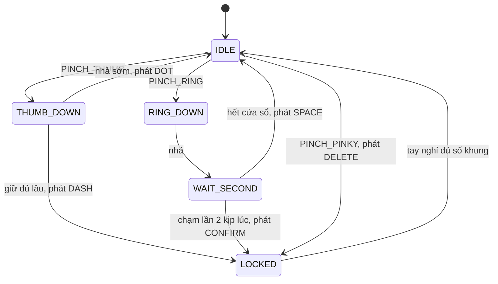

# Gõ mã Morse bằng cử chỉ tay qua webcam

Hand gesture recognition for typing Morse code with a webcam.

[Tiếng Việt](#tiếng-việt) | [English](#english)

---

# Tiếng Việt

## Mục lục
1. [Đề tài và phạm vi](#chương-1-đề-tài-và-phạm-vi)
2. [Bàn tay và bảng Morse](#chương-2-bàn-tay-và-bảng-morse)
3. [Nhãn dữ liệu](#chương-3-nhãn-dữ-liệu)
4. [Thu thập và xử lý dữ liệu](#chương-4-thu-thập-và-xử-lý-dữ-liệu)
5. [Mô hình và máy trạng thái](#chương-5-mô-hình-và-máy-trạng-thái)
6. [Đánh giá](#chương-6-đánh-giá)
7. [Cấu trúc thư mục và cách chạy](#chương-7-cấu-trúc-thư-mục-và-cách-chạy)
8. [Trạng thái dự án](#chương-8-trạng-thái-dự-án)

## Chương 1. Đề tài và phạm vi

Người dùng chụm các đầu ngón tay trước webcam. Hệ thống đọc cử chỉ, ghép thành dấu chấm và dấu gạch, rồi tra bảng Morse để ra chữ. Ví dụ: chụm trỏ–cái nhanh ba lần ra `...`, chạm trỏ–áp út hai lần để xác nhận, kết quả là chữ `S`.

Cách làm: MediaPipe Hands lấy 21 điểm trên bàn tay, từ đó tính 66 đặc trưng số. Một mô hình học máy (KNN, SVM hoặc Random Forest) đoán tư thế bàn tay trên từng khung hình. Máy trạng thái hữu hạn nhìn chuỗi tư thế theo thời gian để quyết định đó là chấm, gạch, xác nhận, dấu cách hay xóa.

Phạm vi hiện tại chỉ gồm chế độ Morse. Đây là bộ cử chỉ điều khiển do đề tài tự quy ước. Nhận diện vài cử chỉ ngón tay không phải dịch ngôn ngữ ký hiệu, vốn còn phụ thuộc chuyển động hai tay, nét mặt và tư thế cơ thể.

## Chương 2. Bàn tay và bảng Morse

MediaPipe trả về 21 landmark, mỗi điểm có tọa độ (x, y, z). Đề tài dùng các điểm sau:

```text
        8 trỏ     12 giữa   16 áp út
        |         |         |         20 út
        7         11        15        |
        6         10        14        19
 4 cái  5         9         13        18
  \     \         |         /         17
   3     `--------+--------'
    2             |
     1            |
      `-------- 0 cổ tay
```

| Điểm | Vai trò |
|---|---|
| 0 cổ tay | gốc tọa độ khi chuẩn hóa |
| 9 gốc ngón giữa | cùng với điểm 0 tạo độ dài lòng bàn tay, dùng làm thước đo |
| 4, 8, 16, 20 | đầu ngón cái, trỏ, áp út, út |

Khoảng cách giữa hai đầu ngón i và j được chia cho độ dài lòng bàn tay để không phụ thuộc bàn tay ở xa hay gần camera:

```text
d(i, j) = sqrt((xi - xj)^2 + (yi - yj)^2) / sqrt((x9 - x0)^2 + (y9 - y0)^2)
```

Bảng Morse quốc tế:

| Chữ | Mã | Chữ | Mã | Chữ | Mã | Số | Mã |
|---|---|---|---|---|---|---|---|
| A | `.-` | J | `.---` | S | `...` | 0 | `-----` |
| B | `-...` | K | `-.-` | T | `-` | 1 | `.----` |
| C | `-.-.` | L | `.-..` | U | `..-` | 2 | `..---` |
| D | `-..` | M | `--` | V | `...-` | 3 | `...--` |
| E | `.` | N | `-.` | W | `.--` | 4 | `....-` |
| F | `..-.` | O | `---` | X | `-..-` | 5 | `.....` |
| G | `--.` | P | `.--.` | Y | `-.--` | 6 | `-....` |
| H | `....` | Q | `--.-` | Z | `--..` | 7 | `--...` |
| I | `..` | R | `.-.` | | | 8 | `---..` |
| | | | | | | 9 | `----.` |

## Chương 3. Nhãn dữ liệu

Năm cử chỉ điều khiển, cộng một nhãn UNKNOWN cho tay nghỉ hoặc tư thế ngoài quy ước:

| Cử chỉ | Thao tác | Tác dụng |
|---|---|---|
| DOT | trỏ chạm cái, chạm nhanh (dưới 0,40 s) | thêm `.` |
| DASH | trỏ chạm cái, giữ (từ 0,40 s) | thêm `-` |
| CONFIRM | trỏ chạm áp út, 2 lần liên tiếp trong 0,45 s | giải mã chuỗi thành một ký tự |
| SPACE | trỏ chạm áp út, 1 lần | thêm dấu cách |
| DELETE | trỏ chạm út, 1 lần | xóa ký hiệu cuối, hoặc ký tự cuối nếu bộ đệm rỗng |
| UNKNOWN | tay mở, không ngón nào chạm | không làm gì |

Có một điểm dễ nhầm: một khung hình không cho biết người dùng chạm nhanh hay đang giữ, cũng không cho biết đây là lần chạm thứ mấy. Nếu bắt mô hình đoán thẳng DOT hay DASH từ một ảnh, hai lớp này giống hệt nhau và mô hình chỉ đoán mò. Nhãn vì thế chia hai tầng:

| Cử chỉ khi thu | Nhãn tư thế (mô hình học) |
|---|---|
| DOT, DASH | PINCH_THUMB |
| CONFIRM, SPACE | PINCH_RING |
| DELETE | PINCH_PINKY |
| UNKNOWN | UNKNOWN |

Mô hình học 4 nhãn tư thế. Máy trạng thái dùng thời gian và số lần chạm để biến chúng thành 5 sự kiện. Dữ liệu thô vẫn lưu cả nhãn cử chỉ (cột `gesture`) lẫn nhãn tư thế (cột `pose`), nên thống kê theo cử chỉ vẫn làm được.

Quy tắc gán nhãn:
- Mỗi mẫu có đúng một nhãn. Khi thu một nhãn, giữ ổn định tư thế và để các ngón còn lại mở tự nhiên. Với DOT và DASH, hãy giữ chụm ngón thay vì gõ nhịp.
- Thu ở nhiều ánh sáng, góc, khoảng cách, nền và cả hai tay.
- Khung hình lỗi bị loại tự động (xem chương 4).
- Tên nhãn viết hoa, giống nhau ở mọi file.

Cặp dễ nhầm nhất là PINCH_RING và PINCH_PINKY: hai ngón này nằm sát nhau, và khi bàn tay nghiêng, ngón áp út có thể che ngón út. Cách xử lý là thu thêm mẫu ở góc nghiêng 30° và dùng khoảng cách trỏ–áp út, trỏ–út làm đặc trưng. Hãy đối chiếu nhận định này với ma trận nhầm lẫn thật của bạn trước khi đưa vào báo cáo.

## Chương 4. Thu thập và xử lý dữ liệu

### Kịch bản thu
Mỗi lần chạy `data_collection.py` là một phiên. Mỗi phiên cố định một bộ điều kiện và thu đủ 6 nhãn; điều kiện thay đổi giữa các phiên.

| Yếu tố | Giá trị |
|---|---|
| Người | tối thiểu 4 (`user_01`, `user_02`, ...) |
| Phiên | 2–3 mỗi người |
| Ánh sáng | `daylight`, `room_light`, `dim_light` |
| Góc quay | `front_0deg`, `angle_30deg` |
| Khoảng cách | `near_35cm`, `mid_50cm`, `far_70cm` |
| Nền | `plain_wall`, `cluttered` |

Chương trình chỉ lưu landmark, không lưu ảnh hay video.

### Khung hình bị loại khi thu
- không thấy tay, hoặc độ tin cậy MediaPipe dưới 0,8;
- có landmark nằm ngoài khung hình (tay bị cắt hoặc che);
- cổ tay dịch quá 0,08 so với khung trước (tay chuyển động nhanh, dễ mờ).

Chương trình không đo độ mờ của ảnh vì không giữ ảnh. Hai bộ lọc đầu và bộ lọc tốc độ cổ tay thay thế cho việc đó. `preprocessing.py` bỏ thêm dòng thiếu giá trị, nhãn lạ, dòng trùng, tay ngoài khung hình và tay lỗi. Số dòng bị bỏ ở từng bước nằm trong `data/processed/cleaning_report.json`.

### 66 đặc trưng
1. Dời gốc về cổ tay: trừ tọa độ điểm 0 khỏi mọi điểm.
2. Tay trái thì lật trục x để dùng chung với tay phải.
3. Chia cho khoảng cách xa nhất tới cổ tay, đưa kích thước bàn tay về cùng thang.
4. Trải phẳng thành 63 giá trị, thêm 3 khoảng cách Euclid chuẩn hóa: trỏ–cái, trỏ–áp út, trỏ–út. Tổng 66.

### Chia tập
70% train, 15% validation, 15% test, chia theo phiên quay (mặc định) hoặc theo người (`--split-by subject`). Mỗi phiên nằm trọn trong một tập.

Lý do: các khung hình liền nhau của một phiên gần như giống hệt. Nếu chia ngẫu nhiên từng khung, bản sao của khung train lọt vào test và độ chính xác test cao giả tạo, rồi tụt mạnh khi người mới dùng. Cần ít nhất 3 phiên; chưa đủ thì script dừng và báo lỗi. Cờ `--allow-frame-split` chỉ dùng để chạy thử.

### Thống kê
`data_analysis.py` ghi `reports/dataset_statistics.json` và các hình phân bố: số mẫu mỗi nhãn, số người, số phiên, ánh sáng, góc quay, khoảng cách, nền.

## Chương 5. Mô hình và máy trạng thái

### Vì sao dùng landmark thay vì ảnh
Đưa cả ảnh webcam vào mạng CNN thì mô hình nặng, bị nền phía sau làm nhiễu, và cần GPU. Ở đây MediaPipe cắt trước thành 66 con số, nên các mô hình cổ điển chạy được trên CPU laptop.

### Ba mô hình
Cả ba chạy sau `StandardScaler`. Siêu tham số chọn theo macro F1 trên tập validation.

| Mô hình | Ý tưởng | Lưới tham số |
|---|---|---|
| KNN | xem K mẫu gần nhất trong tập train thuộc nhãn nào nhiều nhất | `n_neighbors` 3–9, `weights` |
| SVM (RBF) | tìm ranh giới cong tách các tư thế; có `probability=True` để lấy độ tin cậy | `C` 0,1–50, `gamma` |
| Random Forest | nhiều cây quyết định bỏ phiếu | `n_estimators` 50–200, `max_depth` |

SVM và Random Forest dùng `class_weight="balanced"` để nhãn ít mẫu không bị lấn át.

### Máy trạng thái
Mô hình đoán tư thế từng khung hình. Máy trạng thái biến chuỗi tư thế thành lệnh. UNKNOWN và "không thấy tay" đều tính là tay nghỉ.



Giữ một cử chỉ trước webcam 30 FPS không được nhập hàng chục lần. Có bốn cơ chế:
- Ngưỡng tin cậy: xác suất dưới 0,75 coi là UNKNOWN.
- Bỏ phiếu đa số trên 5 khung hình, loại nhiễu một khung.
- Chạm chỉ tính là đã nhả sau 3 khung liên tiếp không còn tư thế đó.
- Sau DASH, CONFIRM, DELETE máy vào trạng thái LOCKED và chỉ mở khi tay nghỉ 3 khung liên tiếp. Người dùng phải thả tay rồi mới nhập tiếp.

Các tham số mặc định nằm trong `src/config.py`. Sửa bằng `models/runtime_config.json` (file này được tạo khi huấn luyện xong, chỉ cần thêm hoặc sửa khóa cần đổi).

### Giải mã
`MorseBuffer` giữ chuỗi đang gõ (tối đa 5 ký hiệu). CONFIRM tra bảng và thêm ký tự (`?` nếu chuỗi không có trong bảng). SPACE xác nhận phần đang chờ rồi thêm dấu cách. DELETE xóa ký hiệu cuối, hoặc ký tự cuối nếu bộ đệm rỗng.

## Chương 6. Đánh giá

`evaluate.py` chạy trên tập test, tập mà huấn luyện chưa từng dùng:
- Accuracy, macro Precision, Recall, F1;
- thời gian suy luận mỗi khung hình (đo bằng `predict_proba`, như lúc chạy webcam);
- báo cáo theo từng nhãn và ma trận nhầm lẫn của từng mô hình;
- ba cặp nhãn bị nhầm nhiều nhất, in ra màn hình.

Kết quả nằm trong `reports/`: `test_results.md`, `test_results.csv`, `<algo>_classification_report.txt`, `figures/<algo>_confusion_matrix.png`. Bảng chọn tham số trên validation ở `reports/validation_results.csv`.

Độ chính xác từng khung hình cao chưa đủ để gõ Morse tốt: máy vẫn có thể nhập thừa, bỏ sót hoặc xác nhận sai lúc. Phần logic thời gian được kiểm bằng các test mô phỏng trong `tests/test_morse_fsm.py` (gõ "SOS", giữ tay không lặp, cửa sổ chạm đúp). Việc đo FPS, độ trễ và gõ thử với người mới trên webcam thật cần làm tay; xem chương 8.

## Chương 7. Cấu trúc thư mục và cách chạy

```text
morse-code-decoder-webcam/
├── data/
│   ├── raw/                    CSV thô: raw/<người>/<phiên>.csv
│   ├── processed/              train.csv, val.csv, test.csv, cleaning_report.json
│   └── dataset_description.md  nguồn, nhãn, kịch bản thu, số liệu thực tế
├── models/                     file .pkl và runtime_config.json (sinh khi huấn luyện)
├── reports/
│   ├── figures/                biểu đồ phân bố, ma trận nhầm lẫn
│   └── report_outline.md       đề cương báo cáo
├── src/
│   ├── config.py               đường dẫn, nhãn, tên cột, tham số
│   ├── hand_tracker.py         bọc MediaPipe Hands
│   ├── data_collection.py      thu dữ liệu qua webcam
│   ├── feature_engineering.py  chuẩn hóa landmark, 3 khoảng cách bổ sung
│   ├── dataset_io.py           đọc dữ liệu thô và đã xử lý
│   ├── splitting.py            chia nhóm vào train/val/test
│   ├── preprocessing.py        làm sạch, tạo đặc trưng, chia tập
│   ├── data_analysis.py        thống kê dữ liệu
│   ├── train_models.py         huấn luyện KNN, SVM, Random Forest
│   ├── evaluate.py             đánh giá trên tập test
│   ├── fsm_controller.py       máy trạng thái và chống nhập lặp
│   └── morse_decoder.py        bảng Morse và bộ đệm văn bản
├── tests/                      29 test, chỉ cần thư viện chuẩn của Python
├── requirements.txt
└── README.md
```

Mỗi file có một việc riêng, nên sửa một chỗ không kéo theo chỗ khác. Thay đổi nhãn hay tên cột chỉ cần sửa `config.py`.

Cài đặt (cần Python 3.9–3.12):

```bash
python3 -m venv venv
source venv/bin/activate            # Windows: venv\Scripts\activate
pip install -r requirements.txt
```

Chạy lần lượt:

```bash
# 0. Kiểm tra logic (không cần webcam)
python3 -m unittest discover tests -v

# 1. Thu dữ liệu: một lệnh cho mỗi phiên, đổi điều kiện giữa các phiên
python3 src/data_collection.py --subject user_01 --session s01 \
    --lighting room_light --angle front_0deg --distance mid_50cm --background plain_wall

# 2. Thống kê dữ liệu thô
python3 src/data_analysis.py

# 3. Làm sạch, tạo đặc trưng, chia 70/15/15
python3 src/preprocessing.py

# 4. Huấn luyện và chọn tham số
python3 src/train_models.py

# 5. Đánh giá trên tập test
python3 src/evaluate.py
```

Phím khi thu: `0` UNKNOWN, `1` DOT, `2` DASH, `3` CONFIRM, `4` SPACE, `5` DELETE, `Space` tạm dừng, `u` xóa đợt vừa ghi, `q` lưu và thoát.

## Chương 8. Trạng thái dự án

Đã có:
- code thu dữ liệu, làm sạch, tạo đặc trưng, chia tập, thống kê, huấn luyện, đánh giá;
- máy trạng thái và bộ giải mã, có test;
- tài liệu mô tả dữ liệu và đề cương báo cáo.

Chưa có:
- dữ liệu thật và các con số kết quả. README này không nêu độ chính xác vì chưa chạy;
- script chạy nhận diện trực tiếp từ webcam, nên chưa đo được FPS, độ trễ và tỷ lệ gõ đúng ký tự trên webcam thật;
- chế độ ký hiệu tĩnh, nằm ngoài phạm vi hiện tại;
- slide và video demo.

Bước tiếp theo: thu ít nhất 3 phiên (khuyến nghị 4 người, mỗi người 2 phiên), rồi chạy lần lượt các lệnh ở chương 7.

---

# English

## Contents
1. [Scope](#chapter-1-scope)
2. [Hand and Morse table](#chapter-2-hand-and-morse-table)
3. [Labels](#chapter-3-labels)
4. [Data collection and processing](#chapter-4-data-collection-and-processing)
5. [Models and state machine](#chapter-5-models-and-state-machine)
6. [Evaluation](#chapter-6-evaluation)
7. [Structure and usage](#chapter-7-structure-and-usage)
8. [Project status](#chapter-8-project-status)

## Chapter 1. Scope

The user pinches fingertips in front of a webcam. The system reads the gesture, builds dots and dashes, and looks the result up in the Morse table. Example: three quick index–thumb pinches give `...`, a double tap of index and ring finger confirms, and the output is `S`.

How it works: MediaPipe Hands returns 21 hand landmarks, from which 66 numeric features are computed. A classic classifier (KNN, SVM or Random Forest) predicts the hand pose on each frame. A finite state machine reads the sequence of poses over time and decides whether it is a dot, dash, confirm, space or delete.

Only Morse mode is implemented. The gestures are control conventions defined by this project. Recognizing a few finger gestures is not sign language translation, which also depends on two-hand motion, facial expression and body posture.

## Chapter 2. Hand and Morse table

MediaPipe returns 21 landmarks with (x, y, z) coordinates. The project uses:

| Point | Role |
|---|---|
| 0 wrist | origin when normalizing |
| 9 middle-finger base | with point 0 gives the palm length, used as a ruler |
| 4, 8, 16, 20 | thumb, index, ring and pinky tips |

The distance between fingertips i and j is divided by palm length, so it does not depend on how far the hand is from the camera:

```text
d(i, j) = sqrt((xi - xj)^2 + (yi - yj)^2) / sqrt((x9 - x0)^2 + (y9 - y0)^2)
```

The Morse table is in the Vietnamese section above (international Morse, A–Z and 0–9) and is implemented in `src/morse_decoder.py`.

## Chapter 3. Labels

Five control gestures plus an UNKNOWN label for a resting hand or any pose outside the convention:

| Gesture | Action | Effect |
|---|---|---|
| DOT | index touches thumb, quick (under 0.40 s) | append `.` |
| DASH | index touches thumb, held (0.40 s or more) | append `-` |
| CONFIRM | index touches ring finger, twice within 0.45 s | decode the buffer into one character |
| SPACE | index touches ring finger, once | append a space |
| DELETE | index touches pinky, once | delete last symbol, or last character if the buffer is empty |
| UNKNOWN | open hand, no touching | nothing |

One frame cannot tell a quick tap from a hold, or the first tap from the second. If the model had to guess DOT versus DASH from a single image, those two classes would be identical and the guess would be random. Labels therefore have two levels:

| Gesture recorded | Pose label (what the model learns) |
|---|---|
| DOT, DASH | PINCH_THUMB |
| CONFIRM, SPACE | PINCH_RING |
| DELETE | PINCH_PINKY |
| UNKNOWN | UNKNOWN |

The model learns 4 pose labels. The state machine turns them into the 5 events using time and tap count. Raw data keeps both the gesture (`gesture` column) and the pose (`pose` column), so per-gesture statistics still work.

Labeling rules:
- One label per sample. While recording a label, hold the pose steady and keep other fingers relaxed. For DOT and DASH, hold the pinch rather than tapping.
- Record under varied lighting, angle, distance and background, with both hands.
- Bad frames are dropped automatically (chapter 4).
- Label names are uppercase and identical in every file.

The most confusable pair is PINCH_RING and PINCH_PINKY. The two fingers sit next to each other, and a tilted hand lets the ring finger hide the pinky. The remedy is extra samples at a 30° angle plus the index–ring and index–pinky distances as features. Check this against your own confusion matrix before putting it in the report.

## Chapter 4. Data collection and processing

### Collection plan
Each run of `data_collection.py` is one session. A session fixes one set of conditions and records all 6 labels; conditions change between sessions.

| Factor | Values |
|---|---|
| Subjects | at least 4 (`user_01`, `user_02`, ...) |
| Sessions | 2–3 per subject |
| Lighting | `daylight`, `room_light`, `dim_light` |
| Angle | `front_0deg`, `angle_30deg` |
| Distance | `near_35cm`, `mid_50cm`, `far_70cm` |
| Background | `plain_wall`, `cluttered` |

Only landmarks are stored, never images or video.

### Frames rejected during collection
- no hand, or MediaPipe confidence below 0.8;
- a landmark outside the frame (hand cut off or covered);
- wrist moved more than 0.08 since the previous frame (fast motion, likely blurred).

The code does not measure image blur because images are not kept; the two checks above and the wrist-speed filter stand in for it. `preprocessing.py` also drops rows with missing values, unknown labels, duplicates, out-of-frame hands and degenerate hands. Row counts per step are saved in `data/processed/cleaning_report.json`.

### The 66 features
1. Move the origin to the wrist.
2. Mirror x for left hands so both hands share one space.
3. Divide by the largest distance from the wrist to scale away hand size.
4. Flatten to 63 values and add 3 normalized Euclidean distances: index–thumb, index–ring, index–pinky. Total 66.

### Splitting
70% train, 15% validation, 15% test, split by recording session (default) or by subject (`--split-by subject`). A session never appears in two sets.

Reason: consecutive frames in a session are nearly identical. A random per-frame split puts copies of training frames in the test set, inflating test accuracy, which then drops when a new user tries the system. At least 3 sessions are required; with fewer the script stops with an error. `--allow-frame-split` is for pilot runs only.

### Statistics
`data_analysis.py` writes `reports/dataset_statistics.json` and distribution plots: samples per label, subjects, sessions, lighting, angle, distance, background.

## Chapter 5. Models and state machine

### Why landmarks instead of images
Feeding raw webcam images to a CNN gives a heavy model that is distracted by the background and needs a GPU. Here MediaPipe reduces each frame to 66 numbers first, so classic models run on a laptop CPU.

### Three models
All three run after `StandardScaler`. Hyperparameters are picked by macro F1 on the validation set.

| Model | Idea | Grid |
|---|---|---|
| KNN | majority label among the K nearest training samples | `n_neighbors` 3–9, `weights` |
| SVM (RBF) | a curved boundary between poses; `probability=True` gives a confidence | `C` 0.1–50, `gamma` |
| Random Forest | many decision trees vote | `n_estimators` 50–200, `max_depth` |

SVM and Random Forest use `class_weight="balanced"` so small classes are not drowned out.

### State machine
The model predicts a pose per frame. The state machine turns pose sequences into commands. UNKNOWN and "no hand" both count as rest. See the diagram in the Vietnamese section.

Holding a gesture in front of a 30 FPS webcam must not type dozens of symbols. Four mechanisms prevent that:
- Confidence threshold: probability under 0.75 is treated as UNKNOWN.
- Majority vote over 5 frames removes single-frame noise.
- A touch counts as released only after 3 consecutive frames without that pose.
- After DASH, CONFIRM and DELETE the machine goes to LOCKED and unlocks only after 3 consecutive rest frames. The user must release before typing again.

Defaults live in `src/config.py`. To change them, edit `models/runtime_config.json` (created after training; add or edit only the keys you want).

### Decoding
`MorseBuffer` holds the sequence being typed (up to 5 symbols). CONFIRM looks it up and appends the character (`?` if the code is not in the table). SPACE confirms anything pending, then adds a space. DELETE removes the last symbol, or the last character if the buffer is empty.

## Chapter 6. Evaluation

`evaluate.py` runs on the test set, which training never touches:
- Accuracy, macro Precision, Recall, F1;
- inference time per frame (measured with `predict_proba`, as in live use);
- per-class report and confusion matrix for each model;
- the three most confused label pairs, printed to the console.

Outputs are in `reports/`: `test_results.md`, `test_results.csv`, `<algo>_classification_report.txt`, `figures/<algo>_confusion_matrix.png`. Validation results are in `reports/validation_results.csv`.

High per-frame accuracy does not guarantee good Morse typing: the machine can still add extra symbols, miss some, or confirm at the wrong moment. The timing logic is checked by simulated tests in `tests/test_morse_fsm.py` (typing "SOS", holding without repeats, the double-tap window). FPS, latency and typing trials with a new user on a real webcam must be done by hand; see chapter 8.

## Chapter 7. Structure and usage

The directory tree is shown in the Vietnamese section. Each file has one job, so a change in one place does not ripple into others. Renaming a label or a column only requires editing `config.py`.

Setup (Python 3.9–3.12):

```bash
python3 -m venv venv
source venv/bin/activate            # Windows: venv\Scripts\activate
pip install -r requirements.txt
```

Run in order:

```bash
python3 -m unittest discover tests -v          # logic tests, no webcam needed
python3 src/data_collection.py --subject user_01 --session s01 \
    --lighting room_light --angle front_0deg --distance mid_50cm --background plain_wall
python3 src/data_analysis.py                   # statistics of raw data
python3 src/preprocessing.py                   # clean, features, 70/15/15 split
python3 src/train_models.py                    # train and tune
python3 src/evaluate.py                        # evaluate on the test set
```

Collection keys: `0` UNKNOWN, `1` DOT, `2` DASH, `3` CONFIRM, `4` SPACE, `5` DELETE, `Space` pause, `u` undo the last burst, `q` save and quit.

## Chapter 8. Project status

Done:
- code for collection, cleaning, features, splitting, statistics, training and evaluation;
- state machine and decoder, with tests;
- dataset description and report outline.

Not done:
- real data and result numbers. This README states no accuracy because nothing has been run;
- a live webcam recognition script, so FPS, latency and typing accuracy on a real webcam are unmeasured;
- static sign mode, which is outside the current scope;
- slides and demo video.

Next step: record at least 3 sessions (4 subjects with 2 sessions each is a good target), then run the commands in chapter 7.
