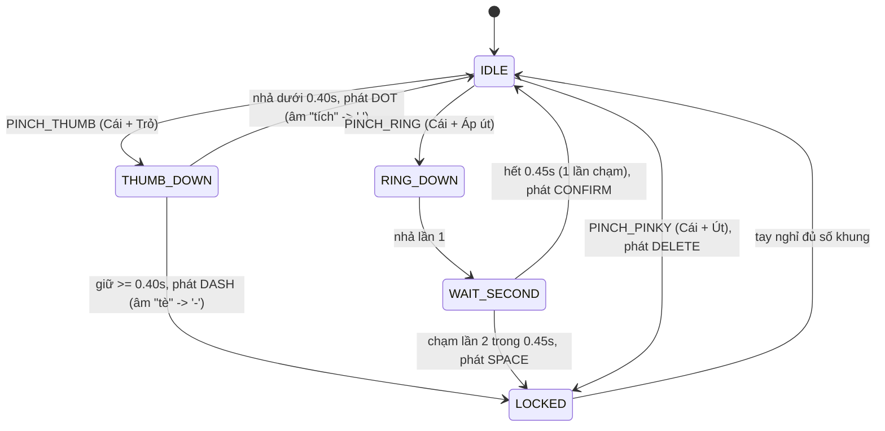

# Gõ mã Morse bằng cử chỉ tay qua webcam

Hand gesture recognition for typing Morse code with a webcam.

**Chạy giao diện web / Run the web UI:**

```bash
python3 src/web_server.py
```

```powershell
.\.venv\Scripts\python.exe -X utf8 src/web_server.py
```

Mở / Open **http://localhost:8000**. Cài đặt, cử chỉ và kiểm thử: [QUICKSTART.md](file:///Users/vuthingockhanh/Documents/morse-code-decoder-webcam/QUICKSTART.md).
Giao diện `web/index.html` + `web/app.js` dùng chung bộ nhận diện, FSM và bộ giải mã Python.

[Tiếng Việt](#tiếng-việt) | [English](#english)

---

# Tiếng Việt

## Mục lục
1. [Đề tài và phạm vi](#chương-1-đề-tài-và-phạm-vi)
2. [Bàn tay và bảng Morse](#chương-2-bàn-tay-và-bảng-morse)
3. [Nhãn dữ liệu và quy ước ngón tay](#chương-3-nhãn-dữ-liệu-và-quy-ước-ngón-tay)
4. [Thu thập và xử lý dữ liệu](#chương-4-thu-thập-và-xử-lý-dữ-liệu)
5. [Mô hình và máy trạng thái](#chương-5-mô-hình-và-máy-trạng-thái)
6. [Đánh giá](#chương-6-đánh-giá)
7. [Cấu trúc thư mục và cách chạy](#chương-7-cấu-trúc-thư-mục-và-cách-chạy)
8. [Trạng thái dự án](#chương-8-trạng-thái-dự-án)

## Chương 1. Đề tài và phạm vi

Người dùng chụm ngón cái với các đầu ngón tay khác trước webcam. Hệ thống đọc cử chỉ, ghép thành dấu chấm và dấu gạch, rồi tra bảng Morse để ra chữ. Ví dụ: chụm cái–trỏ nhanh ba lần ra `...`, chạm cái–áp út 1 lần để xác nhận, kết quả là chữ `S`; chạm cái–áp út 2 lần để cách từ (space).

Cách làm: MediaPipe Hands lấy 21 điểm trên bàn tay, từ đó tính 66 đặc trưng số. Một mô hình học máy (KNN, SVM hoặc Random Forest) đoán tư thế bàn tay trên từng khung hình. Máy trạng thái hữu hạn nhìn chuỗi tư thế theo thời gian để quyết định đó là chấm, gạch, xác nhận, dấu cách hay xóa.

Phạm vi hiện tại chỉ gồm chế độ Morse. Đây là bộ cử chỉ điều khiển do đề tài tự quy ước. Nhận diện vài cử chỉ ngón tay không phải dịch ngôn ngữ ký hiệu, vốn còn phụ thuộc chuyển động hai tay, nét mặt và tư thế cơ thể.

## Chương 2. Bàn tay và bảng Morse

MediaPipe trả về 21 landmark, mỗi điểm có tọa độ (x, y, z). Đề tài dùng các điểm sau:

```text
        8 trỏ     12 giữa   16 áp út
        |         |         |         20 út
        7         11        15        |
        6         10        14        19
 4 cái  5         9         13        18
  \     \         |         /         17
   3     `--------+--------'
    2             |
     1            |
      `-------- 0 cổ tay
```

| Điểm | Vai trò |
|---|---|
| 0 cổ tay | gốc tọa độ khi chuẩn hóa |
| 9 gốc ngón giữa | cùng với điểm 0 tạo độ dài lòng bàn tay, dùng làm thước đo |
| 4 đầu ngón cái | ngón neo chính cho mọi thao tác chụm |
| 8, 16, 20 | đầu ngón trỏ, áp út, út |

Khoảng cách giữa đầu ngón cái (4) và đầu ngón đích j (8, 16, 20) được chia cho độ dài lòng bàn tay để không phụ thuộc bàn tay ở xa hay gần camera:

```text
d(4, j) = sqrt((x4 - xj)^2 + (y4 - yj)^2) / sqrt((x9 - x0)^2 + (y9 - y0)^2)
```

Bảng Morse quốc tế:

| Chữ | Mã | Chữ | Mã | Chữ | Mã | Số | Mã |
|---|---|---|---|---|---|---|---|
| A | `.-` | J | `.---` | S | `...` | 0 | `-----` |
| B | `-...` | K | `-.-` | T | `-` | 1 | `.----` |
| C | `-.-.` | L | `.-..` | U | `..-` | 2 | `..---` |
| D | `-..` | M | `--` | V | `...-` | 3 | `...--` |
| E | `.` | N | `-.` | W | `.--` | 4 | `....-` |
| F | `..-.` | O | `---` | X | `-..-` | 5 | `.....` |
| G | `--.` | P | `.--.` | Y | `-.--` | 6 | `-....` |
| H | `....` | Q | `--.-` | Z | `--..` | 7 | `--...` |
| I | `..` | R | `.-.` | | | 8 | `---..` |
| | | | | | | 9 | `----.` |

## Chương 3. Nhãn dữ liệu và quy ước ngón tay

Năm cử chỉ điều khiển (lấy **ngón cái** làm điểm tựa), cộng một nhãn UNKNOWN cho tay nghỉ hoặc tư thế ngoài quy ước:

| Cử chỉ | Thao tác (Quy ước ngón tay) | Tác dụng |
|---|---|---|
| DOT | **Cái + Trỏ** (`Thumb + Index`), chạm nhanh dưới 0,40 s | phát âm **"tích"**, sau đó nhảy `.` |
| DASH | **Cái + Trỏ** (`Thumb + Index`), giữ từ 0,40 s trở lên | phát âm **"tè"**, sau đó nhảy `-` |
| CONFIRM | **Cái + Áp út** (`Thumb + Ring`), chạm 1 lần | giải mã chuỗi thành một ký tự |
| SPACE | **Cái + Áp út** (`Thumb + Ring`), chạm 2 lần liên tiếp trong 0,45 s | chốt ký tự đang gõ (nếu có) và thêm dấu cách để tách các từ thành câu |
| DELETE | **Cái + Út** (`Thumb + Pinky`), chạm 1 lần | xóa ký hiệu cuối, hoặc ký tự cuối nếu bộ đệm rỗng |
| UNKNOWN | tay mở, không ngón nào chạm | không làm gì |

Có một điểm dễ nhầm: một khung hình không cho biết người dùng chạm nhanh hay đang giữ, cũng không cho biết đây là lần chạm thứ mấy. Nếu bắt mô hình đoán thẳng DOT hay DASH từ một ảnh, hai lớp này giống hệt nhau và mô hình chỉ đoán mò. Nhãn vì thế chia hai tầng:

| Cử chỉ khi thu | Nhãn tư thế (mô hình học) | Cặp ngón chạm |
|---|---|---|
| DOT, DASH | PINCH_THUMB | Cái (4) + Trỏ (8) |
| CONFIRM, SPACE | PINCH_RING | Cái (4) + Áp út (16) |
| DELETE | PINCH_PINKY | Cái (4) + Út (20) |
| UNKNOWN | UNKNOWN | Tay mở / ngoài quy ước |

Mô hình học 4 nhãn tư thế. Máy trạng thái dùng thời gian và số lần chạm để biến chúng thành 5 sự kiện. Dữ liệu thô vẫn lưu cả nhãn cử chỉ (cột `gesture`) lẫn nhãn tư thế (cột `pose`), nên thống kê theo cử chỉ vẫn làm được.

Quy tắc gán nhãn:
- Mỗi mẫu có đúng một nhãn. Khi thu một nhãn, giữ ổn định tư thế và để các ngón còn lại mở tự nhiên. Với DOT và DASH, hãy giữ chụm ngón thay vì gõ nhịp.
- Thu ở nhiều ánh sáng, góc, khoảng cách, nền và cả hai tay.
- Khung hình lỗi bị loại tự động (xem chương 4).
- Tên nhãn viết hoa, giống nhau ở mọi file.

Cặp dễ nhầm nhất là PINCH_RING và PINCH_PINKY: hai ngón này nằm sát nhau, và khi bàn tay nghiêng, ngón áp út có thể che ngón út. Cách xử lý là thu thêm mẫu ở góc nghiêng 30° và dùng khoảng cách cái–áp út (`dist_thumb_ring`), cái–út (`dist_thumb_pinky`) làm đặc trưng.

## Chương 4. Thu thập và xử lý dữ liệu

### Kịch bản thu qua webcam
Mỗi lần chạy `data_collection.py` là một phiên. Mỗi phiên cố định một bộ điều kiện và thu đủ 6 nhãn; điều kiện thay đổi giữa các phiên.

| Yếu tố | Giá trị |
|---|---|
| Người | tối thiểu 4 (`user_01`, `user_02`, ...) |
| Phiên | 2–3 mỗi người |
| Ánh sáng | `daylight`, `room_light`, `dim_light` |
| Góc quay | `front_0deg`, `angle_30deg` |
| Khoảng cách | `near_35cm`, `mid_50cm`, `far_70cm` |
| Nền | `plain_wall`, `cluttered` |

### Khung hình bị loại khi thu
- không thấy tay, hoặc độ tin cậy MediaPipe dưới ngưỡng `MIN_HAND_SCORE`;
- có landmark nằm ngoài khung hình (tay bị cắt hoặc che);
- cổ tay dịch quá 0,08 so với khung trước (tay chuyển động nhanh, dễ mờ).

`preprocessing.py` bỏ thêm dòng thiếu giá trị, nhãn lạ, dòng trùng, tay ngoài khung hình và tay lỗi. Số dòng bị bỏ ở từng bước nằm trong `data/processed/cleaning_report.json`.

### 66 đặc trưng
1. Dời gốc về cổ tay: trừ tọa độ điểm 0 khỏi mọi điểm.
2. Tay trái thì lật trục x để dùng chung với tay phải.
3. Chia cho khoảng cách xa nhất tới cổ tay, đưa kích thước bàn tay về cùng thang.
4. Trải phẳng thành 63 giá trị, thêm 3 khoảng cách Euclid chuẩn hóa: **cái–trỏ** (`dist_thumb_index`), **cái–áp út** (`dist_thumb_ring`), **cái–út** (`dist_thumb_pinky`). Tổng 66.

### Chia tập
70% train, 15% validation, 15% test, chia theo phiên quay (mặc định) hoặc theo người (`--split-by subject`). Mỗi phiên nằm trọn trong một tập.

### Thống kê
`data_analysis.py` ghi `reports/dataset_statistics.json` và các hình phân bố: số mẫu mỗi nhãn, số người, số phiên, ánh sáng, góc quay, khoảng cách, nền.

## Chương 5. Mô hình và máy trạng thái

### Vì sao dùng landmark thay vì ảnh
Đưa cả ảnh webcam vào mạng CNN thì mô hình nặng, bị nền phía sau làm nhiễu, và cần GPU. Ở đây MediaPipe cắt trước thành 66 con số, nên các mô hình cổ điển chạy được trên CPU laptop.

### Ba mô hình
Cả ba chạy sau `StandardScaler`. Siêu tham số chọn theo macro F1 trên tập validation.

| Mô hình | Ý tưởng | Lưới tham số |
|---|---|---|
| KNN | xem K mẫu gần nhất trong tập train thuộc nhãn nào nhiều nhất | `n_neighbors` 3–9, `weights` |
| SVM (RBF) | tìm ranh giới cong tách các tư thế; có `probability=True` để lấy độ tin cậy | `C` 0,1–50, `gamma` |
| Random Forest | nhiều cây quyết định bỏ phiếu | `n_estimators` 50–200, `max_depth` |

SVM và Random Forest dùng `class_weight="balanced"` để nhãn ít mẫu không bị lấn át.

### Máy trạng thái
Mô hình đoán tư thế từng khung hình. Máy trạng thái biến chuỗi tư thế thành lệnh. UNKNOWN, IDLE và "không thấy tay" đều tính là tay nghỉ.



Giữ một cử chỉ trước webcam 30 FPS không được nhập hàng chục lần. Có bốn cơ chế:
- Ngưỡng tin cậy: xác suất dưới 0,75 coi là UNKNOWN.
- Bỏ phiếu đa số trên 5 khung hình, loại nhiễu một khung.
- Chạm chỉ tính là đã nhả sau 3 khung liên tiếp không còn tư thế đó.
- Sau DASH, CONFIRM, DELETE máy vào trạng thái LOCKED và chỉ mở khi tay nghỉ 3 khung liên tiếp. Người dùng phải thả tay rồi mới nhập tiếp.

### Giải mã
`MorseBuffer` giữ chuỗi đang gõ (tối đa 5 ký hiệu). CONFIRM tra bảng và thêm ký tự (`?` nếu chuỗi không có trong bảng). SPACE xác nhận phần đang chờ rồi thêm dấu cách. DELETE xóa ký hiệu cuối, hoặc ký tự cuối nếu bộ đệm rỗng.

## Chương 6. Đánh giá

`evaluate.py` chạy trên tập test, tập mà huấn luyện chưa từng dùng:
- Accuracy, macro Precision, Recall, F1;
- thời gian suy luận mỗi khung hình (ms/khung);
- báo cáo theo từng nhãn và ma trận nhầm lẫn của từng mô hình;
- kiểm thử đầu-cuối đưa chuỗi landmark thật qua `MorseEngine` (detector + ML model + FSM + `MorseBuffer`) để giải mã ra đúng thông điệp Morse.

## Chương 7. Cấu trúc thư mục và cách chạy

```text
morse-code-decoder-webcam/
├── data/
│   ├── raw/                        CSV thô: raw/<người>/<phiên>.csv
│   ├── processed/                  train.csv, val.csv, test.csv, cleaning_report.json
│   └── dataset_description.md      nguồn, nhãn, kịch bản thu, số liệu thực tế
├── models/                         gesture_<algo>_model.pkl và runtime_config.json
├── reports/
│   ├── figures/                    biểu đồ phân bố, ma trận nhầm lẫn
│   └── report_outline.md           đề cương báo cáo
├── src/
│   ├── config.py                   đường dẫn, nhãn, tên cột, tham số
│   ├── hand_tracker.py             bọc MediaPipe Hands
│   ├── data_collection.py          thu dữ liệu qua webcam
│   ├── feature_engineering.py      chuẩn hóa landmark, 3 khoảng cách ngón cái
│   ├── dataset_io.py               đọc dữ liệu thô và đã xử lý
│   ├── splitting.py                chia nhóm vào train/val/test
│   ├── preprocessing.py            làm sạch, tạo đặc trưng, chia tập
│   ├── data_analysis.py            thống kê dữ liệu
│   ├── train_models.py             huấn luyện KNN, SVM, Random Forest
│   ├── evaluate.py                 đánh giá trên tập test
│   ├── fsm_controller.py           máy trạng thái và chống nhập lặp
│   ├── gesture_detector.py         xác định cặp ngón (neo ngón cái), chống rung
│   ├── test_algorithms.py          kiểm thử độc lập các thuật toán & FSM
│   ├── web_server.py               API web nối detector, mô hình, FSM và bộ đệm
│   └── morse_decoder.py            bảng Morse và bộ đệm văn bản
├── web/
│   ├── index.html                  giao diện tương tác webcam + simulator + dịch Morse
│   └── app.js                      kết nối MediaPipe trình duyệt với Python API
├── tests/                          bộ unit test tự động
├── requirements.txt
└── README.md
```

Chạy lần lượt:

```bash
# 0. Kiểm tra logic & unit tests
python3 -m unittest discover tests -v

# 1. Thu dữ liệu mới qua webcam -> tiền xử lý -> huấn luyện -> đánh giá
python3 src/data_collection.py --subject user_01 --session s01
python3 src/preprocessing.py
python3 src/train_models.py
python3 src/evaluate.py

# 2. Khởi chạy giao diện web tương tác tại http://localhost:8000
python3 src/web_server.py
```

## Chương 8. Trạng thái dự án

Đã có:
- quy ước thống nhất lấy ngón cái làm điểm tựa (`Thumb + Index`, `Thumb + Ring`, `Thumb + Pinky`) trên toàn bộ mã nguồn và tài liệu;
- pipeline thu thập dữ liệu, tiền xử lý, huấn luyện và đánh giá 3 mô hình (`KNN`, `SVM`, `Random Forest`);
- máy trạng thái, bộ giải mã Morse, giao diện web tương tác (`web_server.py` + `web/`) và bộ unit test tự động.

---

# English

## Contents
1. [Scope](#chapter-1-scope)
2. [Hand and Morse table](#chapter-2-hand-and-morse-table)
3. [Labels and finger rules](#chapter-3-labels-and-finger-rules)
4. [Data collection and processing](#chapter-4-data-collection-and-processing)
5. [Models and state machine](#chapter-5-models-and-state-machine)
6. [Evaluation](#chapter-6-evaluation)
7. [Structure and usage](#chapter-7-structure-and-usage)
8. [Project status](#chapter-8-project-status)

## Chapter 1. Scope

The user pinches the thumb against other fingertips in front of a webcam. The system reads the gesture, builds dots and dashes, and looks the result up in the Morse table. Example: three quick thumb–index pinches give `...`, a single tap of thumb and ring finger confirms `S`, and a double tap of thumb and ring finger inserts a word space.

How it works: MediaPipe Hands returns 21 hand landmarks, from which 66 numeric features are computed. A classic classifier (KNN, SVM or Random Forest) predicts the hand pose on each frame. A finite state machine reads the sequence of poses over time and decides whether it is a dot, dash, confirm, space or delete.

Only Morse mode is implemented. The gestures are control conventions defined by this project. Recognizing a few finger gestures is not sign language translation, which also depends on two-hand motion, facial expression and body posture.

## Chapter 2. Hand and Morse table

MediaPipe returns 21 landmarks with (x, y, z) coordinates. The project uses:

| Point | Role |
|---|---|
| 0 wrist | origin when normalizing |
| 9 middle-finger base | with point 0 gives the palm length, used as a ruler |
| 4 thumb tip | primary anchor for all pinch gestures |
| 8, 16, 20 | index, ring and pinky tips |

The distance between the thumb tip (4) and fingertip j (8, 16, 20) is divided by palm length, so it does not depend on how far the hand is from the camera:

```text
d(4, j) = sqrt((x4 - xj)^2 + (y4 - yj)^2) / sqrt((x9 - x0)^2 + (y9 - y0)^2)
```

The Morse table is in the Vietnamese section above (international Morse, A–Z and 0–9) and is implemented in `src/morse_decoder.py`.

## Chapter 3. Labels and finger rules

Five control gestures (all anchored on the **thumb**) plus an UNKNOWN label for a resting hand or any pose outside the convention:

| Gesture | Finger Rule & Timing | Effect |
|---|---|---|
| DOT | **Thumb + Index** (`4 + 8`), quick tap (under 0.40 s) | play **"tích"** tone, then append `.` |
| DASH | **Thumb + Index** (`4 + 8`), held (0.40 s or longer) | play **"tè"** tone, then append `-` |
| CONFIRM | **Thumb + Ring** (`4 + 16`), single tap (1 time) | decode the buffer into one character |
| SPACE | **Thumb + Ring** (`4 + 16`), double tap (2 times within 0.45 s) | confirm pending buffer (if any) and append a word space |
| DELETE | **Thumb + Pinky** (`4 + 20`), single tap | delete last symbol, or last character if the buffer is empty |
| UNKNOWN | open hand, no touching | nothing |

One frame cannot tell a quick tap from a hold, or the first tap from the second. Labels therefore have two levels:

| Gesture recorded | Pose label (what the model learns) | Finger pair |
|---|---|---|
| DOT, DASH | PINCH_THUMB | Thumb (4) + Index (8) |
| CONFIRM, SPACE | PINCH_RING | Thumb (4) + Ring (16) |
| DELETE | PINCH_PINKY | Thumb (4) + Pinky (20) |
| UNKNOWN | UNKNOWN | Open hand / non-gesture |

The model learns 4 pose labels. The state machine turns them into the 5 events using time and tap count.

The most confusable pair is PINCH_RING and PINCH_PINKY. The two fingers sit next to each other, and a tilted hand lets the ring finger hide the pinky. The remedy is extra samples at a 30° angle plus the thumb–ring (`dist_thumb_ring`) and thumb–pinky (`dist_thumb_pinky`) distances as features.

## Chapter 4. Data collection and processing

### 66 features
1. Shift origin to the wrist: subtract point 0 from every point.
2. Mirror the x axis for left hands so both hands share one coordinate system.
3. Divide by the farthest distance from the wrist to normalize hand size.
4. Flatten to 63 values and append 3 normalized Euclidean distances: **thumb–index** (`dist_thumb_index`), **thumb–ring** (`dist_thumb_ring`), **thumb–pinky** (`dist_thumb_pinky`). Total: 66.

## Chapter 5. Models and state machine

All three models (`knn`, `svm`, `rf`) run after `StandardScaler`, tuned by macro F1 on the validation set. The state machine (`src/fsm_controller.py`) converts per-frame pose predictions into `DOT`, `DASH`, `SPACE`, `CONFIRM`, and `DELETE` events with majority-vote smoothing, release debouncing, and state locking.

## Chapter 6. Evaluation

`evaluate.py` reports Accuracy, macro Precision/Recall/F1, per-frame inference latency, confusion matrices, and end-to-end Morse text decoding verification.

## Chapter 7. Structure and usage

```bash
python3 -m unittest discover tests -v          # unit tests
python3 src/web_server.py                      # launch web UI at http://localhost:8000
```

## Chapter 8. Project status

Done:
- unified thumb-anchor finger rules across all code, tests, web UI, and documentation;
- data collection, preprocessing, model training and evaluation pipeline;
- state machine, Morse decoder, web UI, and automated test suite.
