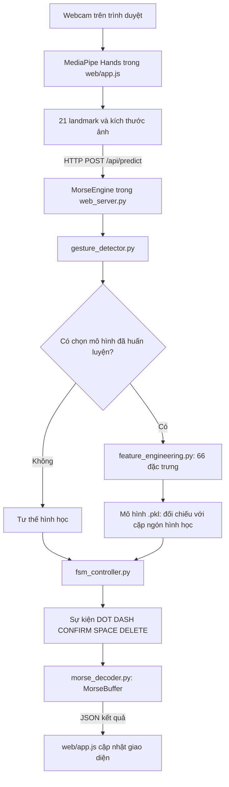
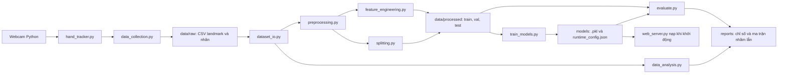

# Thuyết minh cấu trúc và nguyên lý hoạt động hệ thống

Tài liệu mô tả mã nguồn tại thời điểm kiểm tra ngày 12/11/2026. Các số liệu thực nghiệm phải bổ sung từ dữ liệu thực tế, không suy ra từ số lượng kiểm thử.

## 1. Mục tiêu và phạm vi

Hệ thống cho phép người dùng nhập mã Morse bằng các cử chỉ chạm ngón tay qua webcam, giải mã thành chữ cái A–Z và chữ số 0–9. Người dùng xem hình bàn tay, mã đang nhập, ký tự dự kiến và văn bản đã chốt trên trình duyệt.

Đây là bộ cử chỉ điều khiển do đề tài quy ước, chưa phải hệ thống dịch ngôn ngữ ký hiệu. Ứng dụng dùng một bàn tay trong mỗi lần tương tác.

## 2. Cấu trúc thư mục

```text
morse-code-decoder-webcam/
├── web/
│   ├── index.html                  Bố cục HTML và CSS giao diện
│   └── app.js                      Webcam, MediaPipe JS, gửi API, hiển thị
├── src/
│   ├── config.py                   Cấu hình dùng chung
│   ├── web_server.py               Máy chủ HTTP và lớp điều phối MorseEngine
│   ├── gesture_detector.py         Nhận diện cặp ngón bằng hình học
│   ├── fsm_controller.py           Xử lý thời gian và trạng thái cử chỉ
│   ├── morse_decoder.py            Bảng Morse và bộ đệm văn bản
│   ├── hand_tracker.py             MediaPipe Python cho thu thập dữ liệu
│   ├── data_collection.py          Ghi dữ liệu landmark đã gán nhãn
│   ├── dataset_io.py               Đọc CSV thô và các tập đã xử lý
│   ├── data_analysis.py            Thống kê dữ liệu và vẽ biểu đồ
│   ├── feature_engineering.py      Chuẩn hóa và tạo 66 đặc trưng
│   ├── splitting.py                Chia nhóm phiên/người vào các tập
│   ├── preprocessing.py            Làm sạch, tạo đặc trưng và chia tập
│   ├── train_models.py             Huấn luyện KNN, SVM, Random Forest
│   ├── evaluate.py                 Đánh giá mô hình trên tập test
│   └── test_algorithms.py          Kịch bản kiểm thử/đo thử thuật toán
├── tests/                          Các kiểm thử tự động Python và JavaScript
├── data/
│   ├── raw/                        CSV thô sau thu thập
│   ├── processed/                  train.csv, val.csv, test.csv sau xử lý
│   └── dataset_description.md      Mô tả nguồn, nhãn, cách thu và chia dữ liệu
├── models/                         Mô hình .pkl và runtime_config.json khi tạo
├── reports/
│   ├── figures/                    Hình thống kê, ma trận nhầm lẫn khi tạo
│   ├── report_outline.md           Đề cương báo cáo
│   └── system_architecture.md      Tài liệu này
├── README.md                       Tổng quan và hướng dẫn toàn đề tài
├── QUICKSTART.md                   Hướng dẫn chạy giao diện web hiện tại
└── requirements.txt                Thư viện Python cần cài
```

`.venv/` là môi trường Python trên máy, không phải mã nguồn cần trình bày chi tiết. `.git/` chứa lịch sử phiên bản. `.gitkeep` giữ các thư mục rỗng trong Git, không phải dữ liệu huấn luyện.

## 3. Kiến trúc tương tác thời gian thực



### 3.1. Vai trò trình duyệt

`index.html` tạo các vùng hiển thị webcam, nút bật/tắt, bảng thử cử chỉ, thông số nhận diện, bảng Morse và kết quả văn bản. CSS nằm trong tệp HTML.

`app.js` dùng `getUserMedia()` để lấy webcam, chạy MediaPipe Hands bằng JavaScript, vẽ bộ xương tay lên canvas và chuyển landmark thành mảng 21 phần tử, mỗi phần tử chứa `[x, y, z]`. Ảnh webcam không được gửi về Python trong luồng web; chỉ các tọa độ và thông tin khung hình được gửi.

JavaScript không tự phân loại ngón, không có FSM hoặc bộ giải mã Morse riêng. Từ điển Morse hiển thị trên trang cũng lấy từ Python qua `/api/status`.

### 3.2. Vai trò máy chủ

`web_server.py` dùng `HTTPServer` của thư viện chuẩn Python, phục vụ thư mục `web/` và các API. Giao tiếp hiện tại là HTTP với JSON, không sử dụng WebSocket, FastAPI hoặc Flask.

Lớp `MorseEngine` giữ cấu hình, bộ nhận diện hình học, các mô hình đã nạp, FSM và bộ đệm văn bản. Nó kiểm tra dữ liệu đầu vào, chọn thuật toán, đưa tư thế vào FSM rồi trả kết quả để giao diện hiển thị.

| API | Chức năng |
| --- | --- |
| `GET /` | Trả trang `web/index.html` |
| `GET /app.js` | Trả JavaScript của giao diện |
| `GET /api/status` | Trả cấu hình, mô hình đã nạp, bảng Morse và trạng thái hiện tại |
| `POST /api/predict` | Nhận landmark, nhận diện tư thế và cập nhật FSM/bộ đệm |
| `POST /api/fsm_step` | Nhận tư thế mô phỏng từ nút thử, dùng cùng FSM Python |
| `POST /api/cancel` | Hủy cử chỉ dở dang, giữ mã và văn bản đã nhập |
| `POST /api/reset` | Hủy cử chỉ và xóa toàn bộ mã, văn bản |

Các trường kết quả chính là `pose`, `confidence`, `latency_ms`, `state`, `events`, `morse_buffer`, `decoded_text`, `preview`. Các trường nhận diện chỉ có trong những phản hồi phù hợp; ví dụ nút mô phỏng chủ yếu nhận kết quả trạng thái và bộ đệm.

## 4. Thuật toán nhận diện và xử lý thời gian

### 4.1. Nhận diện cặp ngón

`gesture_detector.py` dùng ngón cái, landmark 4, làm ngón chạm chính trong ứng dụng web:

| Cặp ngón | Landmark | Tư thế |
| --- | --- | --- |
| Cái–trỏ | 4–8 | PINCH_THUMB |
| Cái–áp út | 4–16 | PINCH_RING |
| Cái–út | 4–20 | PINCH_PINKY |

Bộ nhận diện sửa tỷ lệ trục y theo chiều cao/chiều rộng ảnh, lấy kích thước lòng bàn tay làm chuẩn và giảm trọng số độ sâu ước lượng. Khoảng cách tiếp xúc được tính bằng khoảng cách Euclid trên tọa độ đã điều chỉnh, chia cho kích thước lòng bàn tay.

Các cơ chế chống nhầm gồm:

- Ngưỡng chạm 0,25 và ngưỡng thả 0,35: hạn chế bật/tắt liên tục khi khoảng cách dao động gần ngưỡng.
- Cặp ngón cần ổn định tối thiểu 0,07 giây trước khi nhận chạm.
- Nếu hai cặp gần như bằng nhau, trả UNKNOWN thay vì chọn tùy ý.
- Không chuyển sang ngón khác trong khi vẫn giữ một cặp ngón.
- IDLE là tư thế nghỉ hợp lệ; UNKNOWN là trường hợp mơ hồ/không hợp lệ.

Trong luồng camera, mất bàn tay, đổi tay, kết quả mơ hồ hoặc độ tin cậy thấp sẽ hủy cử chỉ đang thực hiện. Người dùng cần mở tay trở lại trước khi nhập tiếp. Bộ đệm đã nhập không bị xóa.

### 4.2. Hai tầng nhãn

Mô hình học máy học bốn nhãn tư thế: PINCH_THUMB, PINCH_RING, PINCH_PINKY, UNKNOWN. Khi thu dữ liệu, người dùng có thể chọn sáu nhãn cử chỉ: DOT, DASH, CONFIRM, SPACE, DELETE, UNKNOWN; `config.py` ánh xạ chúng về tư thế để huấn luyện.

Một ảnh đơn chỉ cho biết ngón nào đang chạm, chưa cho biết chạm nhanh hay giữ lâu. Vì vậy DOT/DASH và SPACE/CONFIRM được phân biệt bằng thời gian ở FSM, không phải chỉ bằng mô hình phân loại ảnh đơn.

### 4.3. Máy trạng thái

`fsm_controller.py` làm mượt nhãn bằng bỏ phiếu trên cửa sổ mặc định 5 khung hình và đợi 3 khung thả liên tiếp trước khi kết luận nhả ngón. Nó duy trì các trạng thái IDLE, THUMB_DOWN, RING_DOWN, WAIT_SECOND và LOCKED.

| Thao tác | Sự kiện |
| --- | --- |
| Cái–trỏ chạm nhanh rồi thả, dưới dash_time | DOT |
| Cái–trỏ giữ ít nhất 0,40 giây | DASH |
| Cái–áp út chạm một lần, chờ hết cửa sổ chạm đúp | SPACE |
| Cái–áp út chạm hai lần trong cửa sổ 0,45 giây | CONFIRM |
| Cái–út chạm | DELETE |

Sau các lệnh cần khóa, giữ nguyên tư thế không tạo thêm lệnh; cần về tư thế nghỉ để mở khóa. Tín hiệu quá ngắn bị lọc theo `noise_time`.

Các nút mô phỏng không chạy nhận diện hình học: chúng gửi trực tiếp nhãn tư thế tới `/api/fsm_step`. Trình duyệt tiếp tục gửi khung IDLE sau khi thả nút, nên FSM đủ thông tin để nhận nhả, hết thời gian chạm đúp và mở khóa. Không dùng nút mô phỏng đồng thời với camera.

### 4.4. Giải mã và giữ chữ

`morse_decoder.py` chứa bảng Morse A–Z, 0–9 và `MorseBuffer` với hai vùng dữ liệu:

- `buffer`: chuỗi chấm/gạch của ký tự đang nhập, tối đa 5 tín hiệu.
- `text`: các chữ đã chốt.

DOT/DASH thêm tín hiệu vào `buffer`. CONFIRM tra bảng, thêm ký tự vào `text` rồi làm rỗng `buffer`. SPACE chốt ký tự dở dang rồi thêm một dấu cách nếu cần. DELETE ưu tiên xóa tín hiệu cuối; khi `buffer` rỗng thì xóa ký tự cuối trong `text`. Mã không có trong bảng khi chốt được biểu diễn bằng `?`.

Ví dụ: DOT → DASH → CONFIRM tạo A. Tiếp tục DASH → DOT → CONFIRM tạo N, kết quả `text` là AN. Chốt chữ không xóa chữ đã lưu trước đó.

## 5. Luồng dữ liệu và huấn luyện



1. `hand_tracker.py` bọc MediaPipe Python để tìm 21 landmark. Tệp này phục vụ thu dữ liệu bằng OpenCV; luồng web sử dụng MediaPipe JavaScript riêng trong trình duyệt.
2. `data_collection.py` lọc trường hợp không thấy tay, tay ngoài khung, độ tin cậy thấp hoặc cổ tay dịch quá nhanh; ghi tọa độ, người, phiên, điều kiện và nhãn vào `data/raw/<subject>/<session>.csv`. Không lưu ảnh/video.
3. `dataset_io.py` tập trung quy tắc đọc dữ liệu để các script dùng đúng cột và thứ tự đặc trưng.
4. `data_analysis.py` thống kê dữ liệu thô và sinh `reports/dataset_statistics.json`, biểu đồ phân bố trong `reports/figures/`.
5. `preprocessing.py` bỏ mẫu lỗi/trùng, tạo đặc trưng và gọi `splitting.py` để chia theo phiên hoặc theo người. Mục tiêu tỷ lệ là 70% train, 15% validation, 15% test; do giữ nguyên nhóm nên tỷ lệ thực tế có thể khác.
6. `feature_engineering.py` tạo 66 đặc trưng: 63 tọa độ đã chuẩn hóa về cổ tay, chiều tay và kích thước, cộng 3 khoảng cách 2D cái–trỏ, cái–áp út, cái–út chia theo độ dài lòng bàn tay. Quy tắc 66 đặc trưng này được dùng chung ở lúc huấn luyện và suy luận ML. Nó khác với bộ khoảng cách điều chỉnh độ sâu/tỷ lệ ảnh của detector hình học.
7. `train_models.py` huấn luyện KNN, SVM RBF và Random Forest trong Pipeline gồm StandardScaler và bộ phân loại. Chọn siêu tham số theo macro F1 trên validation, lưu mô hình tốt nhất của mỗi thuật toán vào `models/gesture_<algo>_model.pkl`. Thuật toán tốt nhất được ghi vào `models/runtime_config.json`.
8. `evaluate.py` đọc riêng tập test, tính Accuracy, macro Precision/Recall/F1 và thời gian suy luận; tạo báo cáo từng nhãn cùng ma trận nhầm lẫn. Tập test không dùng để chọn siêu tham số.

Khi chạy web, mô hình ML là tùy chọn. Chế độ auto ưu tiên best_model đã cấu hình nếu có, sau đó mô hình sẵn có; nếu chưa có mô hình thì dùng hình học. Trong chế độ có mô hình, chỉ các cặp ngón hình học đã được xác nhận mới được đối chiếu với dự đoán ML; kết quả trái nhau bị loại để giảm nhập nhầm. Muốn nạp mô hình mới huấn luyện cần khởi động lại máy chủ.

## 6. Kiểm thử

| Tệp | Nội dung |
| --- | --- |
| tests/test_gesture_detector.py | Cặp ngón, ngón chạm chính, chuẩn hóa, ngưỡng chạm/thả, ổn định, mơ hồ |
| tests/test_morse_fsm.py | Nhịp chạm, chống lặp, chạm đúp, giải mã và bộ đệm |
| tests/test_feature_engineering.py | Kích thước vector, khoảng cách, chuẩn hóa |
| tests/test_splitting.py | Chia nhóm và tránh nhóm xuất hiện ở nhiều tập |
| tests/test_algorithms_suite.py | Gọi các kịch bản trong src/test_algorithms.py |
| tests/test_web_server.py | API, mô hình auto, mất tracking, nhập nhiều chữ, kiểm tra đầu vào |
| tests/test_web_client.js | Trình tự gửi API, khung thả liên tục, hiển thị và ngăn trộn nguồn nhập |

`src/test_algorithms.py` chứa các bài kiểm thử/đo thử trên dữ liệu mô phỏng. Kết quả này chứng minh các trường hợp kiểm tra chạy đúng, không thay cho độ chính xác trên dữ liệu người dùng thực tế.

Lần kiểm tra sau đồng bộ ghi nhận 49 kiểm thử Python đạt và kiểm tra JavaScript đạt. Công cụ xem trình duyệt không khả dụng trong lần đó, nên chưa có xác nhận thực nghiệm webcam tương ứng với lần kiểm tra này.

## 7. Trạng thái thực tế và giới hạn cần nêu trong báo cáo

- Khi kiểm tra ngày 12/11/2026, `data/raw/`, `data/processed/`, `models/`, `reports/figures/` mới có `.gitkeep`; chưa có CSV thực nghiệm, mô hình `.pkl` hoặc ma trận nhầm lẫn thực tế. Không ghi rằng đã đạt một mức Accuracy/F1 khi chưa thu và đánh giá dữ liệu.
- Bản demo hiện hoạt động nhờ quy tắc hình học và FSM. Chức năng huấn luyện ML đã có mã nguồn, nhưng cần dữ liệu và chạy đầy đủ quy trình để có kết quả.
- Bảng Morse chỉ có chữ Latin A–Z và chữ số, không mã hóa trực tiếp chữ tiếng Việt có dấu.
- Văn bản giữ trong RAM của máy chủ, chưa tự lưu vào tệp hoặc cơ sở dữ liệu. Các tab dùng chung một MorseEngine; nên dùng một tab trong demo.
- Máy chủ lắng nghe trên 127.0.0.1, không phải website đã triển khai cho nhiều người dùng qua Internet.
- MediaPipe trên web tải tài nguyên từ CDN. Khả năng nhận diện còn phụ thuộc Internet khi tải tài nguyên, ánh sáng, góc tay, che khuất và chất lượng webcam.

## 8. Đoạn mô tả có thể dùng trong báo cáo

“Hệ thống được xây dựng theo kiến trúc giao diện web kết hợp máy chủ Python cục bộ. Trình duyệt thu nhận hình ảnh webcam và sử dụng MediaPipe Hands để trích xuất 21 điểm đặc trưng bàn tay. Các tọa độ được gửi tới máy chủ bằng HTTP/JSON. Bộ nhận diện hình học xác định cặp ngón đang chạm, áp dụng chuẩn hóa theo kích thước bàn tay, ngưỡng chạm/thả và kiểm tra ổn định để giảm nhiễu. Hệ thống có khả năng kết hợp mô hình KNN, SVM hoặc Random Forest sau khi được huấn luyện. Tư thế nhận diện được đưa vào máy trạng thái hữu hạn nhằm phân biệt chạm nhanh, giữ lâu và chạm đúp, từ đó phát sinh các lệnh DOT, DASH, SPACE, CONFIRM và DELETE. Bộ đệm Morse tiếp nhận lệnh, tra bảng mã và tích lũy văn bản đã chốt. Việc tách giao diện, nhận diện tư thế, xử lý thời gian và giải mã thành các mô-đun riêng giúp dùng chung thuật toán giữa thao tác webcam và nút mô phỏng, đồng thời thuận tiện kiểm thử và bảo trì.”

## 9. Chạy minh họa

```powershell
.\.venv\Scripts\python.exe -X utf8 src/web_server.py
```

Mở http://localhost:8000, thử nút mô phỏng trước, sau đó bật camera và cấp quyền cho trình duyệt. Quy trình cài đặt và cách nhập chi tiết nằm trong `QUICKSTART.md`.
